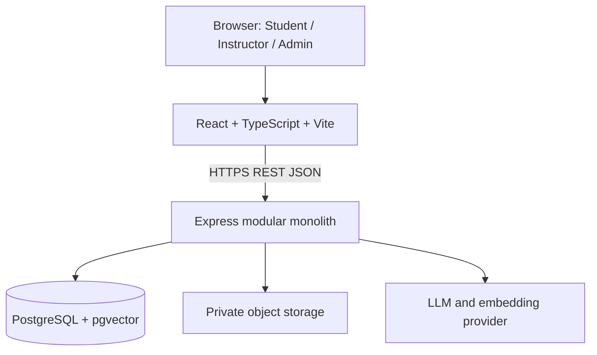
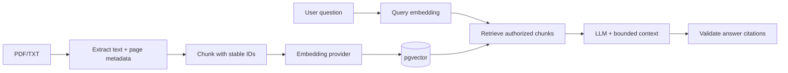

# BrainSpace — Hướng dẫn triển khai

**Phiên bản:** 0.1 | **Trạng thái:** Kế hoạch triển khai đề xuất | **Mục tiêu:** 1.0

Tài liệu mô tả cách xây dựng hệ thống theo [Functional Specification](FUNCTIONAL_SPECIFICATION.md). Hiện chưa có ứng dụng chạy được trong starter kit; các bước triển khai bên dưới là kế hoạch cần được thực hiện và cập nhật bằng kết quả thực tế. Các lệnh có điều kiện không phải lệnh cài đặt đã kiểm thử.

## 1. Kiến trúc và quyết định công nghệ



| Thành phần | Lựa chọn nền tảng đề xuất | Lý do |
|---|---|---|
| Frontend | React, TypeScript, Vite, React Router, Tailwind CSS | Component, SPA, responsive |
| Data/forms | TanStack Query, React Hook Form, Zod | Server state, validation |
| Backend | Node LTS, Express, TypeScript, Prisma | REST, phân module, migrations |
| Auth | JWT access token ngắn hạn + server-side session/refresh token | Logout/revocation có hiệu lực |
| Database | PostgreSQL, pgvector | Quan hệ nghiệp vụ + vector retrieval |
| AI | Một provider hỗ trợ LLM và embedding; adapter chung | Kiểm soát chi phí và đổi provider |
| Storage | S3-compatible hoặc Supabase private bucket | File bền vững sau deploy |
| Testing | Vitest, Supertest, manual E2E (Playwright nếu đủ thời gian) | Test logic, API, UI |
| Deployment | Vercel frontend, Render backend, Supabase hoặc dịch vụ tương đương | Public demo, ít hạ tầng |

Chốt Node/package manager/version ở Sprint 0; commit lockfiles, khai báo engines và version runtime. Chọn provider sau khi thử nghiệm hạn mức, giá, quyền xử lý dữ liệu, embedding dimension và hỗ trợ pgvector. Không chọn microservices, Kubernetes, Redis hay graph DB nếu chưa cần. Kiểm tra tài liệu chính thức theo phiên bản thực tế, đặc biệt cách Prisma kết nối và sử dụng vector SQL.

## 2. Foundation – triển khai theo thứ tự

1. Chọn và thực hiện các Issue M1 đã có trong [Project Roadmap](docs/PROJECT_ROADMAP.md), tạo branch từ main, thống nhất API contract và ERD; kiểm tra Git identity và quyền của cả hai collaborator.
2. Cài Git, Node LTS/npm, VS Code; kiểm tra `git --version`, `node --version`, `npm --version`. Chọn version tương thích Vite và Prisma rồi pin. Cài PostgreSQL + pgvector hoặc tạo DB development riêng trên cloud. Không dùng DB production khi dev.
3. Scaffold React TS bằng Vite (ví dụ `npm create vite@latest frontend -- --template react-ts` từ root sau khi tạm di chuyển `frontend/.env.example` ra khỏi thư mục; restore file sau scaffold). Đọc prompt trước khi cho phép ghi đè. Cài dependencies, cấu hình router, lint/format, layout và route guards. Commit package.json và lockfile. Thêm script lint, typecheck, test, build.
4. Trong `backend/` chạy `npm init -y`, cài Express, TypeScript, validation, ORM, middleware theo version đã chọn. Tạo entry `src/app.ts` (export app, không listen) và `src/server.ts` (listen), config env validate lúc startup, health endpoint, error middleware. Thêm script dev/build/start/lint/typecheck/test. Pin lockfile.
5. Tích hợp Prisma theo version đã chốt; tạo schema và migration đầu tiên; tạo DB role quyền tối thiểu; seed user/course/document demo không có thông tin riêng. Tạo extension vector qua migration đã review; nếu cloud yêu cầu bật extension trước thì ghi rõ. Không reset DB chia sẻ.
6. Đấu nối FE với `GET /api/v1/health` qua base URL và CORS. Health public không trả secret. Thêm readiness kiểm tra DB nếu cần. Thử clone sạch và chạy trước khi merge foundation.
7. Deploy smoke test sớm; chưa bật branch required CI khi check chưa tồn tại. Sau khi workflow lint/typecheck/test/build chạy ổn trên PR, bật required check đúng tên.

## 3. Môi trường và cách chạy trên máy cá nhân

`frontend/.env.example` và `backend/.env.example` đã có sẵn. Copy sang `.env` **tại từng thư mục**, không đưa giá trị thật lên Git. Biến `VITE_*` có thể xuất hiện trong bundle; chỉ public config. Backend validate biến bắt buộc; dev không dùng production credentials.

Sau khi package scripts được triển khai, dùng hai terminal:

```bash
# Terminal 1 (from repo root)
cd backend
npm ci
# Copy .env.example to .env and fill values first
# Proposed scripts: npm run db:migrate, npm run db:seed
npm run dev
```

```bash
# Terminal 2 (from repo root)
cd frontend
npm ci
npm run dev
```

Dự kiến BE :3000, FE :5173; xác nhận theo log thực tế. Migration dev và production phải khác quy trình; đề xuất scripts `db:migrate` cho dev, `db:deploy` cho release, `db:seed` cho demo. Chỉ thêm hướng dẫn copy/paste các script vào README sau khi triển khai, thử nghiệm và commit. Không chạy migration destructive trên DB dùng chung.

## 4. Cấu trúc mã nguồn dự kiến

```text
frontend/src/
  app/router/  app/providers/
  layouts/  components/ui/  components/common/
  features/auth/  features/learning-path/  features/course/
  features/library/  features/tutor/  features/quiz/
  features/flashcards/  features/analytics/  features/admin/
  lib/  hooks/  types/  main.tsx
backend/src/
  config/  database/  middlewares/  shared/
  modules/auth/  modules/user/  modules/learning-path/
  modules/course/  modules/document/  modules/note/
  modules/ai-tutor/  modules/quiz/  modules/flashcard/
  modules/analytics/  modules/admin/
  integrations/ai/  integrations/storage/
  app.ts  server.ts
backend/prisma/   # schema, migrations, seed (planned)
```

Backend module gồm routes → controller → service → repository/ORM. Controller parse request/response; service xử lý nghiệp vụ/authorization/transaction; repository data access; schema validate inputs. Không đưa tất cả logic vào routes. FE feature tổ chức page/component/hooks/API client; TanStack Query quản lý cache, invalidate khi mutation thành công. Không hard-code kết quả backend.

## 5. Xác thực, kiểm tra dữ liệu và xử lý lỗi

- bcrypt với cost đo phù hợp môi trường, validate tối đa 72 byte UTF-8. Access JWT ngắn hạn, verify signature/expiry/issuer/audience; lưu session ID, kiểm tra session còn hiệu lực và user active trên request protected. Refresh token opaque random lưu hash trong DB, rotate, revoke khi logout/change password/lock. Không lưu JWT secret/refresh token plaintext trong DB.
- Đề xuất access token giữ trong memory, refresh cookie HttpOnly/Secure production; chọn SameSite, CORS credentials, CSRF/Origin checks theo hosting thực tế. Nếu cross-site cookie không ổn, ưu tiên reverse proxy/same-site deployment. Không dùng wildcard CORS với credentials. Không lưu token trong localStorage nếu có thể tránh.
- Middleware authenticate → authorize role → resource ownership; kiểm tra lại trong service khi mutation; lấy userId từ verified session, không từ input. Không dùng route guard FE thay cho security BE.
- Zod validate body/query/params, whitelist patch fields; DB constraints là tầng cuối. Central error handler trả code/message/details/requestId (xem API spec), không lộ stack/log secrets. Rate limit login/upload/AI, giới hạn request body.

## 6. Thứ tự triển khai các module

| Step | Domain | Output / integration |
|---|---|---|
| A | Auth & platform | Session, roles, admin, guarded layout; mọi module dùng user context |
| B | Path, Course, Library | CRUD/list/detail/search/filter, topic IDs, document metadata; tối thiểu 3 business entities |
| C | File processing + AI | Upload/extract/chunk/embed, retrieval có quyền, tutor và shared AIService |
| D | Quiz/Flashcard | Draft generation, confirm, snapshot scoring, reviews/due date |
| E | Analytics | Aggregate từ DB, topic accuracy, review recommendation |
| F | Integration | Smoke E2E, privacy tests, deployment, docs |

Có thể làm song song B/C với mock contract ở dev/test; trước release tất cả FE nghiệp vụ gọi REST API thật. Course chỉ dùng text/Markdown/video URL, free enrollment, moderation; ưu tiên hoàn thành loop document → AI → quiz → recommendation trước phần trang admin nâng cao.

## 7. Luồng xử lý RAG và hợp đồng tích hợp AI



- Upload: validate MIME/signature/size, lưu object với generated key, tạo metadata, processing state. Parse PDF text/TXT, cap page/char/chunk count. Chia chunk thử nghiệm khoảng 500–800 tokens, overlap 80–100; điều chỉnh bằng evaluation. Lưu page/offset khi có, không gán trang giả cho TXT. Không OCR trong MVP.
- Embedding: chọn dimension theo model, lưu model/version; không mix vectors khác model. Thực hiện query tham số hóa và filter `owner_id` + `document_id` + READY trước retrieval; nếu Prisma không hỗ trợ vector trực tiếp dùng reviewed parameterized SQL/migration. Top-k đề xuất 4–6, calibrate relevance bằng bộ test; không xem similarity là độ tin cậy tuyệt đối.
- Processing: một worker/queue đơn giản hoặc synchronous có giới hạn và timeout cho bản đầu; không chạy job fire-and-forget trong process dễ bị restart mà không có retry/recovery. Trạng thái FAILED, retry idempotent, cleanup chunk cũ khi reprocess. Không lưu raw file lên disk tạm lâu dài.
- Answer: context là dữ liệu không tin cậy; tách instruction hệ thống, không thực thi câu lệnh trong tài liệu. Output `answer`, `citations` chứa chunk ID được server kiểm tra thuộc tập retrieval. Nếu không đủ căn cứ thì báo rõ; không chế tạo nguồn. Giới hạn lịch sử chat và context.
- Generation: Path, Quiz, Flashcard gọi chung AIService, yêu cầu structured output, validate schema, topic ID, số phần tử, đáp án/citation; preview trước lưu, transaction khi confirm. Lỗi parse không ghi dữ liệu nửa chừng; retry có giới hạn.
- Quota: ghi usage (user, operation, timestamp, token counts nếu provider trả, status); reserve quota atomically trước request, cap tokens, timeout, retry backoff có giới hạn. Không log prompt/raw personal document mặc định. API key chỉ server. Thông báo cho user dữ liệu được gửi provider; không upload tài liệu nhạy cảm khi chưa có quyền/đồng ý.

## 8. Logic nghiệp vụ theo quy tắc xác định

- Quiz attempt snapshot lưu câu hỏi/options/đáp án server-only; khi submit validate mỗi question thuộc snapshot, chấm trong transaction, khóa/unique idempotency ngăn double submit. Không đưa correct answer vào player response. Kết quả đã nộp bất biến.
- Flashcard review transaction: khóa card, kiểm tra client review key unique, lưu history, cập nhật due_at UTC; Again cuối phiên hoặc 10 phút, Hard 1 ngày, Good 3 ngày, Easy 7 ngày. UI dùng local timezone để hiển thị.
- Analytics query theo owner, khoảng thời gian; accuracy có sample size và null khi không có mẫu; topic liên kết bằng ID. Dashboard recommendation rule-based: ưu tiên due card, topic thấp có >=5 mẫu, tài liệu/quiz cùng topic. AI chỉ diễn giải nếu cần.
- Course moderation và archive theo FSM ở Functional Spec; transaction đảm bảo transition hợp lệ. Enrollment unique. Không hard delete course có người học.

## 9. Kiểm thử và triển khai môi trường

Xem [Testing Guide](docs/TESTING_GUIDE.md). Trước khi deploy: build FE/BE, test API auth/owner, kiểm tra migration trên staging, seed demo dữ liệu hợp lệ, giới hạn AI và storage. Cấu hình env riêng trên host, HTTPS, CORS đúng origin, health checks, SPA fallback cho React Router, DB connection pool, backup/restore. Không public bucket. Không cho demo admin quyền quản trị production; dùng tài khoản demo giới hạn hoặc demo role qua môi trường test riêng.

Deployment dự kiến FE Vercel + BE Render + DB/storage cloud; kiểm tra runtime, plan/cold start, storage persistence, database region và quota trước quyết định. Chỉ chạy migration production khi đã review, backup và có kế hoạch rollback. Không chạy seed phá dữ liệu. Sau deploy kiểm tra register/login/logout, library upload, AI tutor, quiz, analytics, mobile, direct route reload. Thêm live URL và hướng dẫn đã kiểm chứng vào README.

## 10. Tài liệu và bàn giao

Mỗi PR sửa nghiệp vụ/API/schema phải cập nhật tài liệu liên quan. [API](docs/API_SPECIFICATION.md) và [DB](docs/DATABASE_DESIGN.md) là draft contract, chuyển thành OpenAPI/schema/migrations thực khi code. [Roadmap](docs/PROJECT_ROADMAP.md) quản lý milestone, GitHub Issues là nguồn trạng thái task. Starter kit chưa có workflow CI hoạt động vì chưa có package scripts. Tạo CI sau khi scaffold #6/#7 và các script đã sẵn sàng; hoàn thành ở #11 trong M1. Không phát hành tag v1.0.0 cho tài liệu khởi tạo. Khi hoàn thành, bàn giao README chạy được, spec/guide, schema/ERD, env templates, source/commits, demo public, slide 3–5 trang và mỗi thành viên trình bày phần mình làm.

## Tài liệu tham khảo khi triển khai

- [React](https://react.dev/learn) · [Vite](https://vite.dev/guide/) · [Express](https://expressjs.com/)
- [Prisma](https://www.prisma.io/docs) · [pgvector](https://github.com/pgvector/pgvector)
- [OWASP Cheat Sheet Series](https://cheatsheetseries.owasp.org/) · [GitHub Actions](https://docs.github.com/en/actions)
