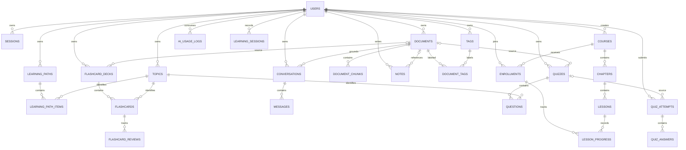

# Database Design – Logical Draft

PostgreSQL + pgvector; đây là ERD logic, **không phải migration/schema đã chạy**. Chốt kiểu dữ liệu, index, FK actions và transaction với cả nhóm. UUID PK đề xuất; UTC timestamps; không lưu derived progress nếu có thể tính.

## Entities and constraints

| Table | Key attributes (besides id, timestamps) | Key constraint / index |
|---|---|---|
| users | email, password_hash, display_name, role, status, preferences | unique normalized email |
| sessions | user_id, refresh_hash, expires_at, revoked_at | unique token hash; user/expires |
| topics | owner_id, normalized_name, label | unique owner/name; per-user canonical topics |
| learning_paths | owner_id, title, goal, level, target_days, minutes_per_day | owner/created index |
| learning_path_items | path_id, topic_id, title, description, sort_order, status | unique path/order; owner checked via path |
| courses | instructor_id, title, description, level, category, status, moderation_reason | instructor/status; published/title |
| chapters | course_id, title, sort_order | unique course/order |
| lessons | chapter_id, title, markdown, video_url, attachment_key, sort_order | unique chapter/order |
| enrollments | user_id, course_id, enrolled_at | unique user/course |
| lesson_progress | enrollment_id, lesson_id, completed_at | unique enrollment/lesson; ensure lesson belongs to same course |
| documents | owner_id, object_key, title, mime_type, size_bytes, status, failure_reason | unique object key; owner/status/created |
| document_chunks | document_id, chunk_index, content, page_start/end, offset, embedding, embedding_model | unique document/index; vector dim tied to model |
| notes | owner_id, document_id nullable, title, markdown | owner/updated index |
| tags | owner_id, name | unique owner/normalized name |
| document_tags | document_id, tag_id | composite unique; same owner |
| conversations | owner_id, document_id nullable, title | owner/updated; document must belong to owner |
| messages | conversation_id, sender, body, citations_json, created_at | conversation/created |
| ai_usage_logs | user_id, operation, status, token_count, request_key | user/day/operation; unique request key as needed |
| quizzes | owner_id, document_id nullable, title, difficulty | owner/created |
| questions | quiz_id, topic_id, prompt, options_json, correct_index, explanation, sort_order | unique quiz/order; validate 4 options/index |
| quiz_attempts | user_id, quiz_id nullable, snapshot_json, status, score, submitted_at | user/submitted index; immutable snapshot |
| quiz_answers | attempt_id, snapshot_question_key, selected_index nullable, is_correct | unique attempt/question; snapshot validates key |
| flashcard_decks | owner_id, document_id nullable, title | owner/created |
| flashcards | deck_id, topic_id, front, back, due_at | deck/due_at |
| flashcard_reviews | flashcard_id, rating, reviewed_at, next_due_at, request_key | unique flashcard/request_key |
| learning_sessions | user_id, start_at, end_at, active_seconds | user/start; optional if time tracking in MVP |

`topics` is per user to simplify ownership; analytics aggregates only the current user's topic IDs. If shared taxonomy is added later, explicitly migrate. Documents can link topics indirectly through questions/cards and path items; for recommendation query matching generated resources via those topic IDs. Optional document-topic mapping can be added if needed. Course categories can initially be validated enums rather than a separate table.

## Integrity and deletion policies

- User account lock is default; deletion/export requires an agreed privacy policy. Sessions revoke when account locked. No raw passwords.
- Child rows for draft paths/courses cascade only where safe; archive courses with enrollment, preserve progress. Published course edits and reorder require transaction. Do not delete topics used by history; restrict or archive.
- Document deletion: mark unavailable first, disable retrieval, remove chunks/private object with retry on failure; set source links null (notes, quizzes, decks, conversations), invalidate old citations or display source unavailable. Conversation history is separate and user can delete it; communicate retention to user. No cross-owner joins.
- Quiz deletion: preserve submitted attempts/snapshots and scores with nullable quiz_id. In-progress attempt can finish against snapshot or be canceled; baseline choose finish. Card deletion removes review history for that card; analytics in MVP only counts current cards. If retention needed, switch to soft-delete.
- Unique constraints and transaction protect duplicate enrollment, progress, attempt submissions and reviews. Reordering uses safe transactional temporary positions or equivalent strategy to avoid unique collision.

## Vector search and migration

Create pgvector extension only on supported DB. Pick embedding dimension and similarity operator with provider; use exact search initially for small data, add suitable index after benchmarking. Parameterized SQL only, join document to enforce current owner and READY state; don't retrieve across users then filter in frontend. Ensure embeddings with different model/dimension are not mixed.

Migration workflow: design PR → dev migration on isolated DB → review SQL → test seed → staging → approved production deploy. Seed sample courses, paths, documents and questions licensed for demo; no real personal data. DB credentials remain in env. Final ERD and Prisma schema must be updated once implementation is validated.
