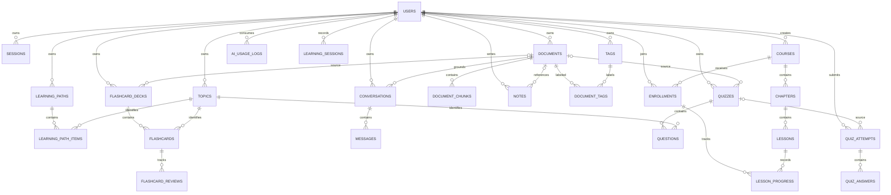

# Thiết kế cơ sở dữ liệu – Bản nháp mô hình logic

PostgreSQL + pgvector; đây là sơ đồ quan hệ thực thể (ERD) ở mức logic, **chưa phải migration/schema đã chạy**. Cả nhóm cần chốt kiểu dữ liệu, chỉ mục (index), cách xử lý khóa ngoại (FK actions) và giao dịch (transaction). Đề xuất dùng UUID làm khóa chính (PK), lưu các mốc thời gian theo UTC; không lưu riêng tiến độ nếu có thể tính từ dữ liệu gốc.

## Thực thể và ràng buộc

| Bảng | Thuộc tính chính (ngoài id và các mốc thời gian) | Ràng buộc / chỉ mục chính |
|---|---|---|
| users | email, password_hash, display_name, role, status, preferences | Email sau chuẩn hóa phải duy nhất |
| sessions | user_id, refresh_hash, expires_at, revoked_at | Hash token duy nhất; chỉ mục theo người dùng/thời điểm hết hạn |
| topics | owner_id, normalized_name, label | Duy nhất theo chủ sở hữu/tên; danh mục chủ đề chuẩn riêng của mỗi người dùng |
| learning_paths | owner_id, title, goal, level, target_days, minutes_per_day | Chỉ mục theo chủ sở hữu/thời điểm tạo |
| learning_path_items | path_id, topic_id, title, description, sort_order, status | Duy nhất theo lộ trình/thứ tự; kiểm tra chủ sở hữu thông qua lộ trình |
| courses | instructor_id, title, description, level, category, status, moderation_reason | Chỉ mục theo giảng viên/trạng thái; khóa học đã xuất bản/tiêu đề |
| chapters | course_id, title, sort_order | Duy nhất theo khóa học/thứ tự |
| lessons | chapter_id, title, markdown, video_url, attachment_key, sort_order | Duy nhất theo chương/thứ tự |
| enrollments | user_id, course_id, enrolled_at | Duy nhất theo người dùng/khóa học |
| lesson_progress | enrollment_id, lesson_id, completed_at | Duy nhất theo lần ghi danh/bài học; bảo đảm bài học thuộc đúng khóa học đã ghi danh |
| documents | owner_id, object_key, title, mime_type, size_bytes, status, failure_reason | object_key duy nhất; chỉ mục theo chủ sở hữu/trạng thái/thời điểm tạo |
| document_chunks | document_id, chunk_index, content, page_start/end, offset, embedding, embedding_model | Duy nhất theo tài liệu/chỉ số đoạn; số chiều vector gắn với model |
| notes | owner_id, document_id cho phép null, title, markdown | Chỉ mục theo chủ sở hữu/thời điểm cập nhật |
| tags | owner_id, name | Duy nhất theo chủ sở hữu/tên đã chuẩn hóa |
| document_tags | document_id, tag_id | Ràng buộc duy nhất trên tổ hợp hai trường; tài liệu và tag phải cùng chủ sở hữu |
| conversations | owner_id, document_id cho phép null, title | Chỉ mục theo chủ sở hữu/thời điểm cập nhật; tài liệu phải thuộc chủ sở hữu cuộc trò chuyện |
| messages | conversation_id, sender, body, citations_json, created_at | Chỉ mục theo cuộc trò chuyện/thời điểm tạo |
| ai_usage_logs | user_id, operation, status, token_count, request_key | Chỉ mục theo người dùng/ngày/thao tác; request_key duy nhất khi cần |
| quizzes | owner_id, document_id cho phép null, title, difficulty | Chỉ mục theo chủ sở hữu/thời điểm tạo |
| questions | quiz_id, topic_id, prompt, options_json, correct_index, explanation, sort_order | Duy nhất theo quiz/thứ tự; kiểm tra 4 lựa chọn và chỉ số đáp án |
| quiz_attempts | user_id, quiz_id cho phép null, snapshot_json, status, score, submitted_at | Chỉ mục theo người dùng/thời điểm nộp; snapshot bất biến |
| quiz_answers | attempt_id, snapshot_question_key, selected_index cho phép null, is_correct | Duy nhất theo lần làm bài/câu hỏi; đối chiếu khóa câu hỏi với snapshot |
| flashcard_decks | owner_id, document_id cho phép null, title | Chỉ mục theo chủ sở hữu/thời điểm tạo |
| flashcards | deck_id, topic_id, front, back, due_at | Chỉ mục theo bộ thẻ/thời điểm đến hạn |
| flashcard_reviews | flashcard_id, rating, reviewed_at, next_due_at, request_key | Duy nhất theo flashcard/request_key |
| learning_sessions | user_id, start_at, end_at, active_seconds | Chỉ mục theo người dùng/thời điểm bắt đầu; tùy chọn nếu MVP có theo dõi thời gian học |

`topics` được tổ chức riêng theo từng người dùng để đơn giản hóa việc kiểm tra quyền sở hữu; phần phân tích học tập chỉ tổng hợp các topic ID của người dùng hiện tại. Nếu bổ sung hệ thống phân loại chủ đề dùng chung sau này, phải thực hiện migration rõ ràng. Tài liệu có thể liên kết gián tiếp với chủ đề thông qua câu hỏi, thẻ và các mục trong lộ trình; truy vấn đề xuất đối chiếu các tài nguyên đã tạo qua những topic ID này. Có thể bổ sung quan hệ ánh xạ trực tiếp giữa tài liệu và chủ đề nếu cần. Ban đầu, danh mục khóa học có thể dùng enum được kiểm tra hợp lệ thay vì một bảng riêng.

## Chính sách toàn vẹn dữ liệu và xóa dữ liệu

- Mặc định xử lý tài khoản bằng cách khóa; việc xóa hoặc xuất dữ liệu cần chính sách quyền riêng tư đã được thống nhất. Thu hồi các phiên khi tài khoản bị khóa. Không lưu mật khẩu dạng rõ.
- Bản ghi con của lộ trình/khóa học nháp chỉ được xóa lan truyền (cascade) khi an toàn; khóa học đã có người ghi danh được lưu trữ (archive), giữ lại tiến độ. Việc sửa khóa học đã xuất bản và sắp xếp lại thứ tự phải dùng transaction. Không xóa chủ đề đã được dùng trong lịch sử; chặn xóa hoặc archive.
- Xóa tài liệu: trước hết đánh dấu không còn khả dụng và chặn truy xuất (retrieval), sau đó xóa các đoạn nội dung (chunk) và đối tượng lưu trữ riêng tư, có retry khi thất bại; đặt liên kết nguồn về null trong note, quiz, deck và conversation, vô hiệu hóa trích dẫn cũ hoặc hiển thị nguồn không còn khả dụng. Lịch sử trò chuyện được quản lý riêng và người dùng có thể xóa; cần thông báo cho người dùng về chính sách lưu giữ. Không truy vấn kết hợp (join) chéo dữ liệu giữa các chủ sở hữu.
- Xóa quiz: giữ lại các lần làm bài đã nộp, snapshot và điểm số bằng cách cho phép quiz_id nhận null. Lần làm bài đang diễn ra có thể hoàn tất theo snapshot hoặc bị hủy; phương án của bản kế hoạch này là cho phép hoàn tất. Xóa thẻ sẽ xóa lịch sử ôn của thẻ đó; phần phân tích trong MVP chỉ tính các thẻ hiện còn. Nếu cần giữ lịch sử, chuyển sang xóa mềm (soft-delete).
- Ràng buộc duy nhất và transaction ngăn tạo trùng lần ghi danh, bản ghi tiến độ, kết quả nộp bài và lượt ôn. Khi sắp xếp lại, dùng các vị trí tạm an toàn trong transaction hoặc cách tương đương để tránh xung đột ràng buộc duy nhất.

## Tìm kiếm vector và quản lý migration

Chỉ tạo extension pgvector trên cơ sở dữ liệu có hỗ trợ. Chọn số chiều embedding và toán tử đo độ tương đồng phù hợp với provider; ban đầu dùng tìm kiếm chính xác (exact search) cho dữ liệu nhỏ, bổ sung chỉ mục phù hợp sau khi đo hiệu năng (benchmark). Chỉ dùng SQL có tham số; kết hợp với bảng tài liệu để kiểm tra chủ sở hữu hiện tại và trạng thái READY trước khi truy xuất. Không truy xuất dữ liệu của nhiều người dùng rồi mới lọc ở Frontend. Bảo đảm không trộn embedding khác model hoặc số chiều.

Quy trình migration: PR thiết kế → chạy migration phát triển trên cơ sở dữ liệu tách biệt → review SQL → kiểm thử seed → staging → triển khai production sau khi được duyệt. Seed các khóa học, lộ trình, tài liệu và câu hỏi mẫu có quyền sử dụng cho demo; không dùng dữ liệu cá nhân thật. Thông tin xác thực cơ sở dữ liệu được giữ trong biến môi trường. Cập nhật ERD và Prisma schema cuối cùng sau khi việc triển khai đã được kiểm chứng.
