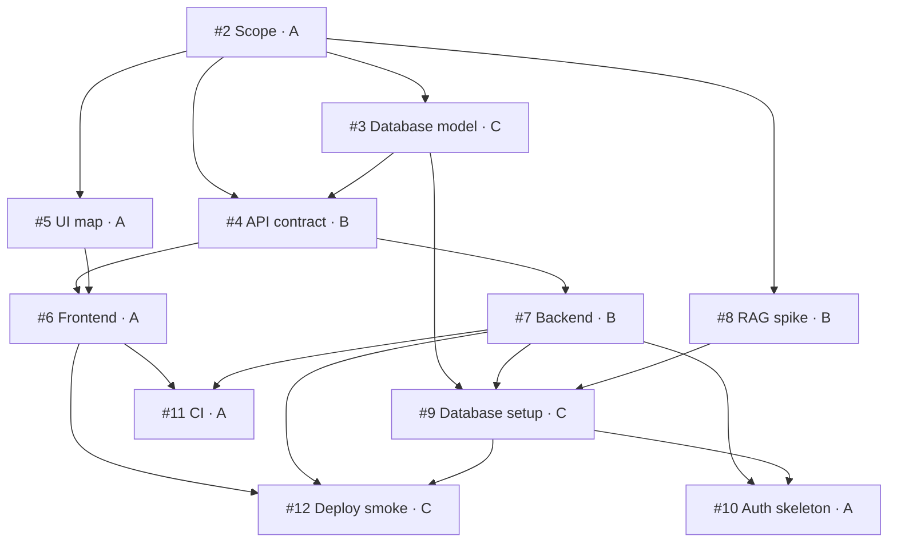
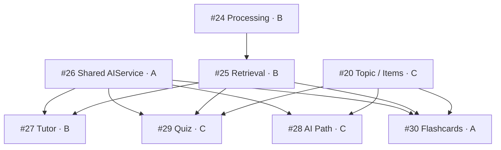
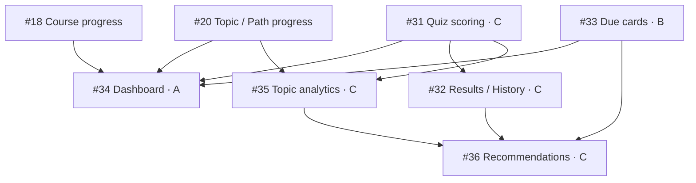
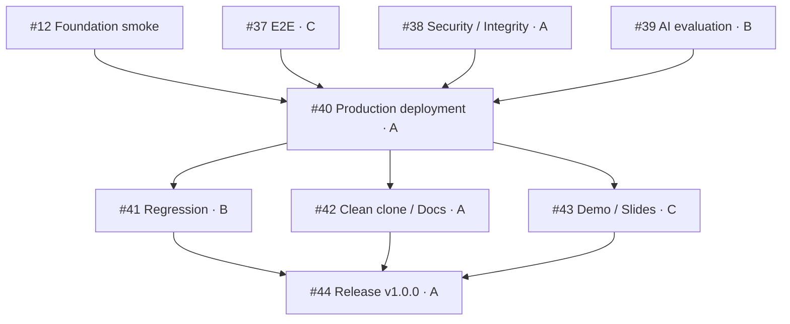

# BrainSpace — Phân tích Dependencies theo Milestone

**Thứ tự ưu tiên, điều kiện bàn giao và cách triển khai song song cho nhóm 3 thành viên.**

| Thông tin | Giá trị |
| --- | --- |
| Phiên bản tài liệu | 1.0 · đối chiếu nguồn ngày **28/11/2026** (UTC+7) |
| Phạm vi | 43 Issue P0: **#2–#44**, thuộc 6 Milestone |
| Kế hoạch gốc | 25/11–16/12/2026; mục tiêu sẵn sàng bàn giao 15/12 |
| Vị trí trong repository | `docs/DEPENDENCY_ANALYSIS.md` |
| Theo dõi kế hoạch | [Project Roadmap](PROJECT_ROADMAP.md) · [Development Board](https://github.com/users/anyl-mely/projects/1) |
| Kiểm tra tiến độ | Mở Issue liên quan và Project để xem trạng thái, người phụ trách và ngày mới nhất |

> **Cách dùng trong buổi làm việc:** chọn Milestone đang triển khai → đọc mục **Ưu tiên bàn giao** → tìm Issue của mình trong bảng → xác định đầu vào đã có, phần có thể làm trước và người cần phối hợp.
>
> **Nguyên tắc chính:** ưu tiên bàn giao đầu ra giúp công việc khác bắt đầu. Thành viên có thể phát triển theo contract/mock đã review; nghiệm thu cần tích hợp thật và đủ Acceptance Criteria (AC) / Definition of Done (DoD).

## Mục lục

- [1. Quy ước và cách xác định ưu tiên](#quy-uoc)
- [2. Tổng quan 6 Milestone](#tong-quan)
- [3. Phân tích theo Milestone](#phan-tich)
  - [M1 — Foundation](#m1-foundation)
  - [M2 — Core CRUD](#m2-core-crud)
  - [M3 — AI](#m3-ai)
  - [M4 — Practice](#m4-practice)
  - [M5 — Integration](#m5-integration)
  - [M6 — Release](#m6-release)
- [4. Các đầu ra cần ưu tiên xuyên Milestone](#ban-giao)
- [5. Cập nhật Dependencies và xử lý việc đang chờ](#cap-nhat)
- [6. Nguồn đối chiếu và thuật ngữ](#nguon)

<a name="quy-uoc"></a>

## 1. Quy ước và cách xác định ưu tiên

### 1.1. Người phụ trách

| Ký hiệu | Thành viên | Phạm vi điều phối chính |
| :---: | --- | --- |
| **A** | [anyl-mely](https://github.com/anyl-mely) | Leader / Platform; Authentication, Course, Dashboard và release |
| **B** | [khongloan9811-arch](https://github.com/khongloan9811-arch) | AI & Knowledge; tài liệu, Notes, RAG và ôn tập flashcards / Spaced Repetition (#33) |
| **C** | [Quanndhe186402](https://github.com/Quanndhe186402) | Learning Intelligence; Database, Learning Path, Quiz, Analytics và enrollment |

**Owner trong bảng từng Issue là đầu mối chịu trách nhiệm kết quả.** Các thành viên vẫn hỗ trợ và review chéo; phạm vi domain không thay thế phân công cụ thể trên Issue.

### 1.2. Đọc Dependencies đúng cách

- **Dependencies trực tiếp**: lấy từ mục Dependencies trong nội dung Issue; mã kế hoạch như `S0-01` được đối chiếu với số Issue thật. Bảng liệt kê đầy đủ từng số, kể cả khi có nhiều đầu vào.
- **Mũi tên trong sơ đồ**: `X → Y` nghĩa là Y cần đầu ra từ X. Các sơ đồ rút gọn sẽ ghi rõ phạm vi; bảng Issue là nơi tra cứu đầy đủ.
- **Điều kiện phối hợp bổ sung**: rút ra từ AC hoặc điểm tích hợp, được giải thích riêng. Ví dụ #3 cần phối hợp với #8 về vector dimension dù dependency khai báo của #3 chỉ có #2.
- **Giờ ước tính**: công sức theo baseline, không phải thời gian lịch hay remaining estimate. Ngày trong tài liệu đều thuộc năm 2026 và là lịch kế hoạch.
- **Đầu ra cần kiểm chứng**: tóm tắt để phối hợp. Mở Issue để đọc đủ AC, test plan và DoD trước khi nghiệm thu.

Các liên kết ở đây là tham chiếu trong tài liệu/Issue. Chỉ riêng việc thêm file này không thiết lập quan hệ **blocked-by** tự động trên GitHub.

### 1.3. Ba tình huống phụ thuộc

| Tình huống | Ví dụ | Có thể làm trước | Cần có để tích hợp/nghiệm thu |
| --- | --- | --- | --- |
| **Đầu vào thực thi bắt buộc** | #13 dùng Backend/Database/Auth skeleton | Form, validation, test case, thiết kế session | Backend/DB thật và phiên xác thực hợp lệ |
| **Phụ thuộc contract** | Frontend dùng API của Backend | UI và service qua mock đúng DTO đã review | API thật đáp ứng contract, gồm lỗi và quyền |
| **Phụ thuộc tích hợp nhiều nguồn** | #34 lấy dữ liệu từ #18, #20, #31, #33 | Layout, DTO tổng hợp, unit test bằng fixture | Dữ liệu nghiệp vụ thật, công thức đúng và cách ly owner |

Tại lần đối chiếu, **28/43 Issue có ít nhất một dependency trực tiếp do thành viên khác phụ trách**; chỉ #2 không có dependency trong tập 43 Issue. Đây là mức độ cần phối hợp, không phải số Issue bị khóa hoàn toàn.

### 1.4. Quy tắc chọn việc tiếp theo

1. **Kiểm tra đầu vào:** Issue cần contract, code, dữ liệu hay bằng chứng kiểm thử nào? Đầu ra đó đã dùng được ở mức nào?
2. **Gỡ phần đang làm người khác chờ:** ưu tiên contract/adapter/migration/session có người tiêu thụ cụ thể và thời điểm cần rõ.
3. **Xét thứ tự nghiệp vụ và năng lực:** cùng một người sở hữu nhiều Issue thì phải chia thời gian; các nhánh kỹ thuật độc lập không đồng nghĩa người đó làm tất cả đồng thời.
4. **Chia phần có thể bàn giao:** contract hoặc PR nhỏ đạt chất lượng có thể được bàn giao trước khi cả Issue hoàn tất; ghi rõ phần tích hợp còn thiếu.
5. **Giữ đủ phạm vi nghiệm thu:** toàn bộ 43 Issue thuộc P0. Thứ tự dưới đây hướng dẫn triển khai trong tập P0; các Issue ít người phụ thuộc vẫn phải được hoàn thành theo kế hoạch.

Milestone là mốc nghiệm thu. Có thể chuẩn bị hoặc triển khai sớm khi đầu vào phù hợp đã rõ, đồng thời ghi thời điểm thực hiện và blocker theo thực tế trên Issue/Project.

<a name="tong-quan"></a>

## 2. Tổng quan 6 Milestone

| Milestone | Cửa sổ baseline | Issue | A / B / C (giờ) | Tổng | Đầu ra cần ưu tiên để giảm chờ |
| --- | --- | ---: | --- | ---: | --- |
| [M1 — Foundation](#m1-foundation) | 25–27/11 | 11 | 10 / 8 / 9 | 27h | Scope, ERD/API, quyết định provider, Backend/DB và Auth skeleton |
| [M2 — Core CRUD](#m2-core-crud) | 28/11–01/12 | 11 | 27 / 15 / 15 | 57h | Auth thật; document upload/management; topic/progress; course/lesson contract |
| [M3 — AI](#m3-ai) | 02–05/12 | 7 | 10 / 18 / 12 | 40h | Shared AIService, processing/retrieval, quiz và flashcard contract |
| [M4 — Practice](#m4-practice) | 06–09/12 | 6 | 5 / 5 / 19 | 29h | Quiz scoring/history, due cards, topic analytics và dữ liệu Dashboard |
| [M5 — Integration](#m5-integration) | 10–12/12 | 4 | 9 / 5 / 5 | 19h | Bằng chứng E2E, authorization và AI evaluation; production smoke |
| [M6 — Release](#m6-release) | 13–16/12 | 4 | 5 / 4 / 3 | 12h | Regression, clean clone, demo và quyết định phát hành |
| **Tổng** | **25/11–16/12** | **43** | **66 / 55 / 63** | **184h** | **Đủ release gate của 7 module P0** |

**Điểm cần cân đối công sức:** A có 27h ở M2, B có 18h ở M3 và C có 19h ở M4. Đây là các cửa sổ nên lên lịch hỗ trợ/review sớm, sau khi kiểm tra thời gian thực tế của từng thành viên.

<a name="phan-tich"></a>

## 3. Phân tích theo Milestone

<a name="m1-foundation"></a>

### 3.1. M1 — Foundation

**25–27/11 · 11 Issue · 27h · A/B/C: 10/8/9h**

**Mục tiêu:** tạo các hợp đồng kỹ thuật và nền tảng chạy được để ba nhánh nghiệp vụ ở M2 có thể phát triển đồng thời.

#### Ưu tiên bàn giao

1. **Cả nhóm hoàn tất quyết định của [#2][i2].** A điều phối phạm vi, quyền, kế hoạch và phân công. Việc roadmap đã merge là một đầu ra của kickoff; các xác nhận còn lại được kiểm tra theo AC trong Issue.
2. **Mở ba phần việc sau scope:** A làm [#5][i5] (UI), B làm [#8][i8] (RAG spike), C làm [#3][i3] (ERD). B/C trao đổi sớm về model và vector dimension.
3. **B bàn giao [#4][i4] khi mô hình dữ liệu đủ rõ.** API contract giúp A triển khai [#6][i6] và B triển khai [#7][i7]. B cần bố trí thời gian giữa spike và API/Backend, vì đây vẫn là cùng một owner.
4. **C tích hợp [#9][i9] với schema, Backend và kết quả spike.** A dùng Backend/DB để hoàn thiện [#10][i10]. [#11][i11] và [#12][i12] được chuẩn bị đồng thời, nghiệm thu khi các thành phần cần kiểm tra đã sẵn sàng.

#### Sơ đồ Dependencies trong M1



Sơ đồ thể hiện các dependency khai báo của M1. Các điều kiện tích hợp bổ sung được nêu ngay sau bảng.

#### Bảng công việc

| Issue / mã kế hoạch | Owner · giờ | Dependencies trực tiếp | Đầu ra cần kiểm chứng |
| --- | :---: | --- | --- |
| [#2][i2] · `S0-01` — **Phạm vi, quyền và kế hoạch** | A · 1h | — | Cả nhóm xác nhận 7 module P0, actor/ownership, lịch và phân công; roadmap đã được cập nhật qua PR. |
| [#3][i3] · `S0-02` — **Mô hình dữ liệu** | C · 2h | [#2][i2] | ERD, khóa/quan hệ, unique/index, topic ownership, snapshot, quy tắc xóa/archive; chốt vector dimension cùng #8. |
| [#4][i4] · `S0-03` — **API contract** | B · 2h | [#2][i2], [#3][i3] | Endpoint /api/v1, request/response, validation, pagination, mã lỗi, role/ownership và ví dụ mock được cả nhóm review. |
| [#5][i5] · `S0-04` — **Sitemap và wireframe** | A · 2h | [#2][i2] | Màn hình theo actor; navigation và form/list/detail; trạng thái loading/empty/error, responsive và keyboard. |
| [#6][i6] · `S0-05` — **Khởi tạo Frontend** | A · 3h | [#4][i4], [#5][i5] | Layout/router/API client, script lint/typecheck/test/build, phiên bản runtime và lockfile; kiểm tra health thật khi Backend sẵn sàng. |
| [#7][i7] · `S0-06` — **Khởi tạo Backend** | B · 3h | [#4][i4] | App/server, cấu trúc module, env validation, CORS, error middleware, health và kiểm thử API cơ bản. |
| [#8][i8] · `S0-08` — **Thử nghiệm RAG provider** | B · 3h | [#2][i2] | Kết quả extract/embedding/retrieval; quyết định model, dimension, quota, chi phí ước tính, timeout và cách xử lý lỗi. |
| [#9][i9] · `S0-07` — **Database, migration và seed** | C · 4h | [#3][i3], [#7][i7], [#8][i8] | PostgreSQL/Prisma/pgvector với dimension đúng; DB dev/test, migration/seed chạy được, Backend kết nối thật. |
| [#10][i10] · `S0-11` — **Khung Authentication** | A · 2h | [#7][i7], [#9][i9] | User/session contract, authenticate/authorize và route guard; kiểm thử 401/403. Session đầy đủ được triển khai ở #13. |
| [#11][i11] · `S0-09` — **CI cho Pull Request** | A · 2h | [#6][i6], [#7][i7] | Lint/typecheck/test/build cho ứng dụng chạy thành công; tên check rõ để cấu hình required checks sau khi đã xác nhận. |
| [#12][i12] · `S0-10` — **Deploy smoke nền tảng** | C · 3h | [#6][i6], [#7][i7], [#9][i9] | Frontend có URL, Backend health qua HTTPS, DB kết nối được; kiểm tra route/env/CORS và lưu bằng chứng smoke. |

#### Làm song song và tránh chờ

| Thành viên | Phần có thể chuẩn bị | Điểm cần nhận từ người khác |
| --- | --- | --- |
| **A** | UI map, layout/route, test cho guard và bản nháp CI | API contract từ B; Backend và DB để kiểm tra kết nối/session skeleton |
| **B** | Spike provider, phác thảo endpoint/DTO; sau đó khung Backend | Scope từ cả nhóm; entity/constraints từ C để chốt API |
| **C** | Bảng nghiệp vụ, ERD, seed mẫu, migration và kế hoạch deploy | Model/dimension từ spike của B; Backend để kiểm tra DB; Frontend để smoke |

**Hai điểm phối hợp cần ghi rõ:**

- [#3][i3] chỉ khai báo phụ thuộc #2, nhưng AC yêu cầu vector dimension sau spike #8. C có thể thiết kế các bảng nghiệp vụ trước; phần vector còn mở phải được ghi lại và chốt với B trước khi nghiệm thu đầy đủ.
- [#6][i6] khai báo #4/#5, nhưng kiểm thử health thật cần Backend #7. Hoàn tất scaffold riêng chưa đủ cho phần AC tích hợp này.

**Điều kiện chuyển tiếp:** API/ERD có phiên bản được review; FE/BE/DB chạy theo hướng dẫn; Auth skeleton, CI và smoke có bằng chứng. Từng phần M2 có thể bắt đầu khi đầu vào tương ứng dùng được, trong khi nhóm tiếp tục hoàn thiện các AC còn lại của M1.

<a name="m2-core-crud"></a>

### 3.2. M2 — Core CRUD

**28/11–01/12 · 11 Issue · 57h · A/B/C: 27/15/15h**

**Mục tiêu:** hoàn thiện Authentication và dữ liệu nghiệp vụ làm nền cho AI, luyện tập và Dashboard.

#### Ưu tiên bàn giao

1. **A ưu tiên [#13][i13] và bàn giao user/session contract sớm.** Sáu Issue khai báo trực tiếp #13: [#14][i14], [#15][i15], [#16][i16], [#19][i19], [#21][i21] và [#26][i26] ở M3.
2. **Sau nền Auth/DB, triển khai ba nhánh:** A làm Course/Admin; B làm Library/Notes; C làm Learning Path/Topic. Mỗi nhánh có thể chuẩn bị UI/service/mock trước khi nối Auth thật.
3. **Ưu tiên đầu vào cho M3:** B bàn giao upload/management [#21][i21]/[#22][i22]; C bàn giao topic/items [#20][i20]; A hoàn thiện Auth #13 để Shared AIService sử dụng identity/quota.
4. **A/C phối hợp khóa học:** A bàn giao course/lesson/permissions ở [#16][i16]/[#17][i17]; C tích hợp enrollment/progress [#18][i18]. C vẫn làm #19/#20 trong lúc chờ phần Course.

#### Bảng công việc

| Issue / mã kế hoạch | Owner · giờ | Dependencies trực tiếp | Đầu ra cần kiểm chứng |
| --- | :---: | --- | --- |
| [#13][i13] · `CORE-01` — **Đăng ký và xác thực phiên** | A · 7h | [#10][i10] | Đăng ký/login/logout, phiên thật, rotate/revoke, user active, role do server gán, rate limit và Frontend guard. |
| [#14][i14] · `CORE-02` — **Hồ sơ và mật khẩu** | A · 4h | [#13][i13] | Chỉnh sửa hồ sơ đúng owner, kiểm tra mật khẩu cũ khi đổi, xử lý phiên theo AC và giao diện tương ứng. |
| [#15][i15] · `CORE-03` — **Admin và phân quyền** | A · 5h | [#13][i13] | Quản lý user, role guard, lock/unlock, bảo vệ admin cuối cùng; kiểm thử quyền và người dùng bị khóa. |
| [#16][i16] · `CORE-04` — **Danh mục và CRUD khóa học** | A · 5h | [#9][i9], [#13][i13] | Catalog published, tìm kiếm/lọc, Instructor quản lý khóa học thuộc mình, archive; tích hợp DB/Auth thật. |
| [#17][i17] · `CORE-05` — **Chương, bài học và duyệt khóa học** | A · 6h | [#15][i15], [#16][i16] | Chapter/lesson, reorder và chuyển trạng thái; Instructor/Admin thao tác đúng quyền trong luồng kiểm duyệt. |
| [#18][i18] · `CORE-06` — **Ghi danh và tiến độ khóa học** | C · 5h | [#16][i16], [#17][i17] | Enrollment unique, quyền truy cập bài học, tiến độ do server tính, phạm vi Instructor; dữ liệu đầu vào cho Dashboard. |
| [#19][i19] · `CORE-07` — **CRUD và tìm kiếm Learning Path** | C · 5h | [#9][i9], [#13][i13] | Path thuộc owner, validation, tìm kiếm/lọc/phân trang và giao diện; hoạt động với DB/Auth thật. |
| [#20][i20] · `CORE-08` — **Path items, Topic và tiến độ** | C · 5h | [#19][i19] | Topic ID thống nhất theo owner, items/reorder trong transaction, cách tính tiến độ và contract dùng chung. |
| [#21][i21] · `CORE-09` — **Upload tài liệu riêng tư** | B · 5h | [#9][i9], [#13][i13] | Kiểm tra loại/nội dung/kích thước file, private storage, metadata UPLOADED, lỗi upload và ownership. |
| [#22][i22] · `CORE-10` — **Quản lý tài liệu, tag và tìm kiếm** | B · 6h | [#21][i21] | List/detail/download đúng quyền; search/filter; xóa chặn truy cập và retrieval, cleanup và chính sách giữ dữ liệu liên quan. |
| [#23][i23] · `CORE-11` — **Smart Notes CRUD** | B · 4h | [#21][i21] | CRUD note theo owner, liên kết tài liệu, Markdown an toàn và xử lý link khi nguồn bị xóa. |

#### Làm song song và tránh chờ

| Thành viên | Phần có thể làm trước | Điều kiện tích hợp thật |
| --- | --- | --- |
| **A** | Form Auth/Profile, ma trận quyền, Course editor/catalog | Phiên thật và DB; kiểm thử role + ownership cho từng thao tác |
| **B** | Storage adapter, upload UI/validator, document/note UI, test bằng identity fixture | User được xác thực ở server; storage riêng tư, dữ liệu/nguồn đúng owner |
| **C** | Path/item/topic UI và logic tiến độ; trang học theo course contract | Auth/DB thật; Course/Lesson đủ quyền và trạng thái để kiểm tra #18 |

**Điểm nghẽn:** A có tổng 27h trong M2. Nên bàn giao session/identity và Course contract theo từng PR nhỏ, bố trí B/C hỗ trợ test, fixture hoặc phần UI có phạm vi rõ. Đầu vào `userId`/`role` giả lập chỉ phục vụ test/dev; lúc chạy thật phải lấy từ phiên đã được server xác thực.

**Điều kiện chuyển tiếp:** CRUD và quyền đã được kiểm tra; tài liệu có metadata/ownership và quy tắc xóa rõ; topic ID/progress thống nhất. Các module AI có thể chuẩn bị contract trước, rồi tích hợp trên đầu vào thật tương ứng.

<a name="m3-ai"></a>

### 3.3. M3 — AI

**02–05/12 · 7 Issue · 40h · A/B/C: 10/18/12h**

**Mục tiêu:** dùng chung AIService, dữ liệu truy xuất và topic contract để triển khai Tutor, AI Path, Quiz và Flashcards nhất quán.

#### Ưu tiên bàn giao

1. **A triển khai [#26][i26] từ kết quả [#8][i8] và Auth [#13][i13].** B cùng review interface provider/retrieval, model/dimension, quota và lỗi để các chức năng AI dùng thống nhất.
2. **B bàn giao lifecycle/chunk contract của [#24][i24], rồi tích hợp [#25][i25].** Đồng thời chuẩn bị Tutor UI/conversation; phần trả lời có nguồn cần retrieval và AIService thật.
3. **C ưu tiên [#28][i28] khi #20/#26 sẵn sàng.** AI Path không khai báo phụ thuộc #25; C có thể hoàn thiện luồng này trong lúc B tiếp tục retrieval. Quiz editor thủ công ở #29 cũng có thể triển khai sớm.
4. **C/A chuẩn bị Quiz/Flashcard thủ công và draft UI**, sau đó nối generation khi #20/#25/#26 đáp ứng contract. A ưu tiên đầu ra Shared AIService trước phần Flashcards do cùng mình phụ trách.

#### Sơ đồ hội tụ đầu vào cho các chức năng AI



Sơ đồ tập trung vào các đầu vào chung của bốn chức năng AI. Các dependency khác của #24/#25/#26 được liệt kê đầy đủ trong bảng.

#### Bảng công việc

| Issue / mã kế hoạch | Owner · giờ | Dependencies trực tiếp | Đầu ra cần kiểm chứng |
| --- | :---: | --- | --- |
| [#24][i24] · `AI-01` — **Extract và vòng đời xử lý tài liệu** | B · 5h | [#21][i21], [#22][i22], [#8][i8] | Extract/chunk, trạng thái, stable chunk ID/page/offset, retry/cleanup; READY thực tế sau khi tích hợp #25. |
| [#25][i25] · `AI-02` — **Embeddings và vector retrieval** | B · 6h | [#24][i24], [#9][i9], [#8][i8] | Lưu embedding đúng model/dimension/version; lọc owner/document/READY, giới hạn context, trả nguồn thật; tích hợp lifecycle #24. |
| [#26][i26] · `AI-03` — **AIService, quota và structured output** | A · 5h | [#8][i8], [#13][i13] | Adapter LLM/embedding chung, quota atomic, timeout/retry có giới hạn, validate output, lỗi nhất quán và smoke provider thật. |
| [#27][i27] · `AI-04` — **AI Tutor có nguồn** | B · 7h | [#25][i25], [#26][i26] | Conversation/chat theo owner, retrieval thật, câu trả lời có citation hợp lệ, quota và xử lý thiếu nguồn/lỗi provider. |
| [#28][i28] · `AI-05` — **AI Learning Path dạng bản nháp** | C · 5h | [#20][i20], [#26][i26] | Draft đúng schema; preview/sửa/confirm; chỉ lưu path/items nguyên tử khi xác nhận, hỗ trợ cách tạo thủ công. |
| [#29][i29] · `AI-06` — **Quiz thủ công và AI Quiz** | C · 7h | [#20][i20], [#25][i25], [#26][i26] | Quiz editor, câu hỏi/đáp án/topic hợp lệ; AI draft kiểm tra schema/source, preview/confirm, kiểm thử owner và lỗi provider. |
| [#30][i30] · `AI-07` — **Flashcard và AI tạo thẻ** | A · 5h | [#20][i20], [#25][i25], [#26][i26] | Deck/card CRUD, topic thuộc owner; AI draft từ document READY, validate source, preview/confirm và giữ thẻ khi xóa nguồn. |

#### Xử lý quan hệ #24 và #25

Dependency khai báo là **#25 phụ thuộc #24**. Tuy nhiên, AC của #24 cho phép kiểm thử state machine bằng embedding adapter giả lập, còn trạng thái **READY thật** chỉ có sau khi tích hợp #25 và lưu đủ embedding cho các chunk.

Cách bàn giao đề xuất:

1. B chốt trạng thái, chunk ID, page/offset, interface embedding và quy tắc retry/cleanup.
2. B tạo phần triển khai/test lifecycle có thể review; ghi rõ embedding đang giả lập ở đâu và PR/commit nào chứa contract.
3. Phát triển #25 trên contract đó, đồng bộ adapter dùng chung với A ở #26.
4. Kiểm thử tích hợp #24/#25 với embedding thật, lỗi giữa chừng, retry, nguồn đã xóa và cross-owner. Hoàn tất từng Issue khi đạt đủ AC/DoD.

**Vì vậy, điều kiện bắt đầu phần code #25 là đầu ra phù hợp của #24 đã sẵn sàng, không phải thao tác đóng Issue #24.** #25 và #26 cần review interface cùng nhau; #26 không nằm trong danh sách dependency khai báo của #25 ở baseline này.

#### Làm song song và tránh chờ

| Thành viên | Phần có thể làm trước | Điểm bàn giao cần ưu tiên |
| --- | --- | --- |
| **A** | AIService interface/quota/error contract; sau đó deck/card editor | Adapter và structured output cho B/C; card/topic contract cho B làm #33 |
| **B** | Extract/chunk, lifecycle, vector query với fixture, chat UI | Retrieval trả nguồn thật; model/dimension nhất quán với A; trạng thái READY đúng |
| **C** | AI Path preview/confirm; Quiz thủ công, schema và editor | Topic contract cho A/B; Quiz schema/snapshot đầu vào cho #31 |

**Điểm nghẽn:** B có 18h và sở hữu processing, retrieval, Tutor. A/C nên dùng mock theo contract để làm phần giao diện và xử lý draft, đồng thời hỗ trợ B kiểm thử nguồn/quyền theo phạm vi đã thống nhất.

**Điều kiện chuyển tiếp:** bốn chức năng AI dùng provider thật với quota/lỗi/validation đúng; Tutor có citation thật; dữ liệu được kiểm tra owner/source. Mock là đầu vào phát triển, còn evidence nghiệm thu phải phản ánh tích hợp thật.

<a name="m4-practice"></a>

### 3.4. M4 — Practice

**06–09/12 · 6 Issue · 29h · A/B/C: 5/5/19h**

**Mục tiêu:** tạo dữ liệu học tập đáng tin cậy từ Quiz/Flashcards, rồi tổng hợp thành Dashboard, Analytics và gợi ý ôn tập.

#### Ưu tiên bàn giao

1. **C ưu tiên [#31][i31]**, chốt snapshot, cách chấm điểm và attempt/result contract; đây là đầu vào của #32, #34 và #35.
2. **B triển khai [#33][i33] song song**, sau khi có card contract/đầu ra #30. B bàn giao due count/due_at cho A và C sớm.
3. **C phát triển [#32][i32] và [#35][i35] theo phần dữ liệu đã có.** Hai phần cùng owner C nên cần sắp thứ tự và chia phạm vi hỗ trợ.
4. **A tích hợp [#34][i34] khi bốn nguồn #18/#20/#31/#33 có dữ liệu đúng.** C hoàn thiện [#36][i36] từ #32/#33/#35. UI và unit test của cả hai chức năng có thể chuẩn bị trước.

#### Sơ đồ dữ liệu cho Dashboard và đề xuất ôn tập



Sơ đồ thể hiện các quan hệ tổng hợp trong M4; #31 còn cần #29 và #33 còn cần #30 như bảng dưới.

#### Bảng công việc

| Issue / mã kế hoạch | Owner · giờ | Dependencies trực tiếp | Đầu ra cần kiểm chứng |
| --- | :---: | --- | --- |
| [#31][i31] · `PRAC-01` — **Quiz attempt và chấm điểm** | C · 7h | [#29][i29] | Snapshot bất biến, DTO làm bài không lộ đáp án, chấm điểm phía server, submit idempotent và transaction. |
| [#32][i32] · `PRAC-02` — **Kết quả, lịch sử và làm lại Quiz** | C · 4h | [#31][i31] | Kết quả dựa trên snapshot, lịch sử theo owner và retry tạo attempt mới; kết quả cũ được giữ nguyên. |
| [#33][i33] · `PRAC-03` — **Spaced repetition và thẻ đến hạn** | B · 5h | [#30][i30] | Flip/rate, review transaction/idempotency, due_at UTC, danh sách đến hạn theo owner và due count cho Dashboard. |
| [#34][i34] · `PRAC-04` — **Learning Dashboard** | A · 5h | [#18][i18], [#20][i20], [#31][i31], [#33][i33] | Tổng hợp tiến độ path/course, quiz accuracy, due cards từ DB theo owner; bộ lọc 7/30 ngày và trạng thái rỗng chính xác. |
| [#35][i35] · `PRAC-05` — **Analytics theo Topic** | C · 4h | [#31][i31], [#20][i20] | Correct/answered theo topic/owner, số mẫu và trạng thái chưa đủ dữ liệu; tính đúng ngưỡng đã quy định trong Issue. |
| [#36][i36] · `PRAC-06` — **Đề xuất hoạt động ôn tập** | C · 4h | [#32][i32], [#33][i33], [#35][i35] | Ưu tiên due cards/topic yếu đủ mẫu; chỉ dẫn đến tài liệu, quiz hoặc thẻ thực sự tồn tại và thuộc owner. |

#### Làm song song và tránh chờ

| Thành viên | Phần có thể làm trước | Cần thống nhất khi nhận dữ liệu |
| --- | --- | --- |
| **A** | Dashboard layout, bộ lọc 7/30 ngày, DTO tổng hợp, fixture rỗng/đầy | Công thức progress/accuracy, due count, owner, zero/null và khoảng thời gian |
| **B** | Thuật toán review/due date và unit test với clock cố định | Card ID/topic từ A; due_at UTC, idempotency và due count cho A/C |
| **C** | Test scoring/snapshot, results UI, analytics và rule recommendation | Dữ liệu Quiz đúng snapshot; topic ID dùng chung; due cards từ B |

**Điểm nghẽn:** C có 19h trong M4. A/B có thể hỗ trợ UI, fixture hoặc test theo subtask được C bàn giao; owner và phạm vi review phải rõ. Một thay đổi về cách tính Quiz accuracy hoặc topic ID cần được báo cho cả Dashboard và Recommendations.

**Điều kiện chuyển tiếp:** số liệu học tập được tính từ dữ liệu nghiệp vụ thật, bao gồm tình huống rỗng/ít mẫu; Quiz scoring và review bảo đảm transaction/idempotency; kiểm tra cách ly hai user. Không dùng AI hoặc fixture để tạo thành tích học tập giả trong runtime thật.

<a name="m5-integration"></a>

### 3.5. M5 — Integration

**10–12/12 · 4 Issue · 19h · A/B/C: 9/5/5h**

**Mục tiêu:** kiểm tra hệ thống như một sản phẩm tích hợp, rồi xác nhận bản deployment thực tế.

#### Ưu tiên bàn giao

1. **Chuẩn bị test plan, fixture và tài khoản kiểm thử từ trước M5.** Khi một luồng đã tích hợp, có thể chạy kiểm thử luồng đó sớm và ghi rõ coverage còn thiếu.
2. **Ba nhánh kiểm thử có thể chạy song song:** C thực hiện E2E #37; A kiểm tra authorization/integrity #38; B đánh giá AI #39. Dùng dữ liệu/tài khoản được phân tách hoặc thống nhất thao tác reset để tránh ảnh hưởng bài test của nhau.
3. **Triage bug theo domain và mức ảnh hưởng.** Issue kiểm thử lưu kết quả; lỗi cần sửa được liên kết với bug/PR tương ứng. Owner của chức năng phối hợp khắc phục và người kiểm thử retest.
4. **A nghiệm thu [#40][i40] sau các đầu vào #37/#38/#39/#12.** Có thể chuẩn bị cấu hình và deploy ứng viên sớm để kiểm thử, nhưng public smoke cuối phải chạy trên bản tích hợp đã xử lý blocker.

#### Bảng công việc

| Issue / mã kế hoạch | Owner · giờ | Dependencies trực tiếp | Đầu ra cần kiểm chứng |
| --- | :---: | --- | --- |
| [#37][i37] · `INT-01` — **Kiểm thử các hành trình E2E** | C · 5h | [#17][i17], [#18][i18], [#23][i23], [#27][i27], [#28][i28], [#29][i29], [#30][i30], [#32][i32], [#33][i33], [#34][i34], [#35][i35], [#36][i36] | Luồng học và luồng Instructor/Admin chạy trên hệ thống tích hợp; test matrix, trạng thái UI và bằng chứng theo commit/môi trường. |
| [#38][i38] · `INT-02` — **Kiểm thử quyền và toàn vẹn** | A · 5h | [#15][i15], [#22][i22], [#27][i27], [#31][i31], [#33][i33] | Role/owner/session, private file, transaction/idempotency, DTO và cấu hình bảo mật; xử lý và retest blocker nghiêm trọng. |
| [#39][i39] · `INT-03` — **Đánh giá RAG và độ tin cậy AI** | B · 5h | [#27][i27], [#28][i28], [#29][i29], [#30][i30] | Bộ câu hỏi có/không có đáp án và adversarial; ghi grounding/citation, quota/timeout/schema, không rò rỉ chéo owner. |
| [#40][i40] · `INT-04` — **Tích hợp production deployment** | A · 4h | [#37][i37], [#38][i38], [#39][i39], [#12][i12] | Build/runtime/env, HTTPS, migration/backup/rollback, private storage; public smoke dùng AI thật, route reload và DB persistence. |

**[#37][i37] có 12 dependency trực tiếp.** Bảng ghi đủ từng Issue để tránh bỏ sót Quiz/Flashcards hoặc bất kỳ nguồn Analytics nào. Đầu ra #31/#20 còn liên quan gián tiếp qua các chức năng tiêu thụ, dù không nằm trong danh sách trực tiếp của #37.

**Bằng chứng bàn giao:** commit, môi trường/URL, test case, expected/actual, PASS/FAIL/BLOCKED và link bug/retest. Nếu một đầu vào chưa có thì ghi phần kiểm thử bị chặn; phần khác đã đủ điều kiện vẫn có thể chạy.

**Điều kiện chuyển tiếp:** các test tích hợp, quyền và AI evaluation đạt yêu cầu; deployment HTTPS/public smoke, route reload, AI thật và DB persistence được xác nhận. Thời điểm deploy ban đầu và thời điểm nghiệm thu #40 có thể khác nhau.

<a name="m6-release"></a>

### 3.6. M6 — Release

**13–16/12 · 4 Issue · 12h · A/B/C: 5/4/3h**

**Mục tiêu:** xác nhận bản bàn giao có thể chạy lại, trình diễn được và có bằng chứng chất lượng đầy đủ. Mục tiêu sẵn sàng ngày 15/12; ngày 16/12 dành cho kiểm tra cuối và bàn giao theo baseline.

#### Ưu tiên bàn giao

1. **Sau đầu ra #40, ba nhánh chạy song song:** B làm regression #41; A hoàn thiện docs/clean clone #42; C chuẩn bị/rehearsal demo #43.
2. **A bố trí B hoặc C thực hiện clean clone thật cho #42.** A vẫn chịu trách nhiệm Issue; AC yêu cầu một thành viên khác kiểm chứng hướng dẫn.
3. **Thống nhất commit/phiên bản ứng viên phát hành.** Bugfix sau regression hoặc rehearsal cần được kiểm thử lại ở phần chịu ảnh hưởng; evidence ghi đúng bản đang định bàn giao.
4. **A điều phối [#44][i44] khi #41/#42/#43 đạt đầu ra bắt buộc.** Cả nhóm xác nhận release gate trước khi tag `v1.0.0` và tạo GitHub Release.

#### Sơ đồ hội tụ kiểm thử và phát hành



Sơ đồ nối M5 và M6. Các đầu vào riêng của #37/#38/#39 được tra cứu tại bảng M5.

#### Bảng công việc

| Issue / mã kế hoạch | Owner · giờ | Dependencies trực tiếp | Đầu ra cần kiểm chứng |
| --- | :---: | --- | --- |
| [#41][i41] · `REL-01` — **Regression và xử lý release blocker** | B · 4h | [#40][i40] | Chạy/ghi bằng chứng 26 test case, triage/retest bug, xác nhận public smoke và AI thật; ghi known limitations. |
| [#42][i42] · `REL-02` — **Clean clone và tài liệu cuối** | A · 3h | [#40][i40] | Một thành viên khác clone sạch và làm theo README; API/schema/ERD/env/live URL và hướng dẫn khớp bản được nghiệm thu. |
| [#43][i43] · `REL-03` — **Dữ liệu demo, slide và walkthrough** | C · 3h | [#40][i40] | Kịch bản học và course moderation, dữ liệu hợp lệ, slide, rehearsal; cả ba thành viên trình bày phần thực hiện. |
| [#44][i44] · `REL-04` — **Phát hành BrainSpace v1.0.0** | A · 2h | [#41][i41], [#42][i42], [#43][i43] | Cả nhóm xác nhận release gate, PR/CI/public smoke đạt; tag đúng commit main, release notes và bộ bàn giao đầy đủ. |

**Có thể chuẩn bị trước:** README, runbook, checklist regression, slide và kịch bản demo. **Cần chờ bản tích hợp để xác nhận:** kết quả regression, clean clone theo hướng dẫn cuối, rehearsal trên deployment và quyết định phát hành.

**Điều kiện hoàn tất:** đủ 7 module P0 và test/release gate; không còn blocker nghiêm trọng theo tiêu chí đã chốt; có commit/tag, live URL, evidence, tài liệu và known limitations. Chỉ đóng milestone sau khi đầu ra thực tế đã được kiểm chứng.

<a name="ban-giao"></a>

## 4. Các đầu ra cần ưu tiên xuyên Milestone

### 4.1. Bản đồ bàn giao giữa ba thành viên

| Đầu ra | Đầu mối | Bên sử dụng chính | Nội dung cần giao sớm |
| --- | --- | --- | --- |
| **Scope và quyền** | A · [#2][i2], cả nhóm xác nhận | A/B/C | P0/out-of-scope, actor/ownership, ngày và phân công |
| **ERD/Database** | C · [#3][i3], [#9][i9] | A/B/C | Entity/PK/FK/unique, migration/seed, ownership/delete; vector dimension cùng B |
| **API/Backend** | B · [#4][i4], [#7][i7] | A/C và các module Backend | Endpoint/DTO, mã lỗi, validation, pagination, ví dụ request/response và health |
| **Authentication** | A · [#10][i10], [#13][i13] | B làm Library; C làm Path; A làm Course/Admin | Identity/session được xác thực, role/owner checks, 401/403 và quy tắc từ chối tài nguyên |
| **Topic và tiến độ** | C · [#20][i20] | A/B/C | Topic ID/owner, dữ liệu path/items, công thức progress, quy tắc dùng chung |
| **Document lifecycle/retrieval** | B · [#24][i24], [#25][i25] | A làm Flashcards; C làm Quiz; B làm Tutor | Trạng thái READY, chunk/source/page/offset, lọc owner và xử lý nguồn đã xóa |
| **Shared AIService** | A · [#26][i26], B review provider | A/B/C | Interface LLM/embedding, quota, timeout/retry, output schema và lỗi |
| **Quiz result và Topic stats** | C · [#31][i31], [#32][i32], [#35][i35] | A làm Dashboard; C làm Recommendations | Snapshot/result, correct/answered, số mẫu, null/empty và topic ID |
| **Due cards** | B · [#33][i33] | A làm Dashboard; C làm Recommendations | due_at UTC, due count, owner, thứ tự ưu tiên và idempotency |
| **Bản ứng viên phát hành** | A · [#40][i40] | B regression; A/docs; C/demo | Commit, URL/môi trường, migration, hướng dẫn chạy và phạm vi cần retest |

### 4.2. Một số đầu vào có ảnh hưởng rộng

“Số Issue phía sau” là số Issue khác có thể đi tới theo chiều mũi tên từ Issue đầu vào trong tập 43 Issue. Mỗi Issue chỉ được tính một lần, dù tồn tại nhiều đường đi. Số này giúp nhận biết tác động lan truyền; cần kết hợp blocker thực tế, effort và lịch của owner khi ưu tiên. **Đây không phải phép tính đường găng CPM hoặc số task đang bị khóa.**

| Issue | Owner | Số Issue phía sau | Quyết định phối hợp |
| --- | :---: | ---: | --- |
| [#2][i2] — Scope | A | 42 | Chốt quyết định nhóm sớm để các nhánh có cùng phạm vi |
| [#3][i3] — Database model | C | 39 | Bàn giao entity/constraints; ghi rõ phần vector chờ spike |
| [#4][i4] — API contract | B | 38 | Bàn giao DTO/mã lỗi/mock để triển khai FE/BE |
| [#7][i7] — Backend | B | 36 | Có nền app/health/config dùng được cho DB và Auth |
| [#8][i8] — RAG spike | B | 35 | Chốt model/dimension trước cấu hình vector và AIService |
| [#9][i9] — Database setup | C | 34 | Bảo đảm migration/seed/kết nối thật cho các module |
| [#10][i10] — Auth skeleton | A | 32 | Chốt identity/guard contract dùng chung |
| [#13][i13] — Authentication | A | 31 | Ưu tiên phiên thật để các domain tích hợp quyền |
| [#26][i26] — Shared AIService | A | 18 | Bàn giao interface chung để triển khai bốn chức năng AI |

Bảng chọn các đầu vào tiêu biểu, không phải thứ tự làm việc tuần tự. Ví dụ #3/#5/#8 được triển khai theo các nhánh sau scope; #26 vẫn cần #8/#13 dù số Issue phía sau của nó nhỏ hơn.

<a name="cap-nhat"></a>

## 5. Cập nhật Dependencies và xử lý việc đang chờ

### 5.1. Phân biệt tiến độ của Issue và khả năng dùng đầu ra

| Tình trạng đầu vào | Cách xử lý công việc tiếp theo |
| --- | --- |
| Chưa rõ yêu cầu hoặc contract | Đọc spec, chuẩn bị câu hỏi/test case; chốt đầu ra cần nhận với owner trước khi viết phần tích hợp |
| Contract đã review; triển khai thật còn thiếu | Làm phần UI/service/unit test bằng mock phù hợp; ghi phần đã mở khóa và phần vẫn chờ |
| Có PR/commit dùng được cho phạm vi cần thiết | Nhận bàn giao, tích hợp phần đó; PR nhỏ vẫn tuân thủ review/CI và giữ main chạy được |
| Chức năng thật đã đáp ứng đầu vào | Chạy integration test, negative test và ghi evidence cho AC liên quan |
| Toàn bộ AC/DoD đạt | Nghiệm thu và cập nhật trạng thái Issue/Project theo [Git Workflow](GIT_WORKFLOW.md) |

**Một Issue đang mở vẫn có thể có contract hoặc phần triển khai đã bàn giao.** Khi bắt đầu việc dựa trên phần đó, phải nêu rõ phạm vi và commit/version đang dùng để người review biết phần nào đã được kiểm chứng.

### 5.2. Mẫu ghi nhận blocker hoặc bàn giao

Điền mẫu sau trong comment của Issue đang làm. Đây là mẫu đề xuất để sử dụng thống nhất trong nhóm:

```text
Dependency / đầu vào cần nhận:
Owner cung cấp:
Contract hoặc PR/commit liên quan:
Phần đã sẵn sàng:
Phần công việc tôi có thể tiếp tục:
Phần còn bị chặn và lý do:
Thời điểm cần bàn giao / thời điểm kiểm tra lại:
Bằng chứng test hoặc cách chạy thử:
```

Ví dụ: A làm #34 đã có progress contract và Quiz result, còn chờ due count của #33. A tiếp tục layout/unit test bằng fixture đã thống nhất; B bàn giao response schema, cách tính thời điểm và PR/commit; sau đó A kiểm tra Dashboard với dữ liệu thật.

### 5.3. Checklist trước khi nhận và bàn giao việc

Theo [Git Workflow](GIT_WORKFLOW.md), PR vào `main` cần **ít nhất một approval độc lập**, kiểm thử phù hợp và merge commit. Người viết thay đổi không tự thay thế reviewer độc lập; khi pair programming, nhóm bố trí người review độc lập với phần cùng thực hiện.

- [ ] Đã đọc Issue, owner, AC, dependency và đầu ra cần sử dụng.
- [ ] Đã phân biệt phần chuẩn bị, phần triển khai theo mock và phần tích hợp thật.
- [ ] Contract có link/version, ví dụ thành công/lỗi và quy tắc quyền/dữ liệu rõ ràng.
- [ ] Người tiêu thụ biết cách chạy thử và biết phần nào chưa sẵn sàng.
- [ ] Thay đổi contract/schema đã được trao đổi với các owner bị ảnh hưởng.
- [ ] PR một phần ghi `Refs #n`; chỉ dùng từ khóa tự đóng Issue khi PR thực sự đáp ứng toàn bộ AC/DoD liên quan.
- [ ] Đã kiểm thử tích hợp/owner/negative case cần thiết và ghi evidence trước khi nghiệm thu.
- [ ] Issue, Project và tài liệu liên quan phản ánh đúng quyết định mới.

### 5.4. Khi kế hoạch hoặc Dependencies thay đổi

1. Owner và thành viên tiêu thụ thống nhất đầu vào thay đổi, tác động và thời điểm cần dùng.
2. Cập nhật Dependencies/AC trong Issue, liên kết Issue liên quan và ghi lý do. Nếu dùng quan hệ blocked-by native, đối chiếu để hai nơi thống nhất.
3. Cập nhật `PROJECT_ROADMAP.md` và file này qua PR nếu baseline/đồ thị/phân công thay đổi; ghi ngày đối chiếu mới.
4. Cập nhật các field và trạng thái trên Project theo thực tế; giữ dấu vết baseline và lý do điều chỉnh để nhóm so sánh kế hoạch với kết quả.

**Nguồn xử lý chênh lệch:** mở Issue và contract/PR liên quan để kiểm tra quyết định mới nhất, trao đổi với owner, rồi đồng bộ tài liệu. Mỗi ngày chỉ cần cập nhật tiến độ tại Issue/Project; file phân tích được sửa khi quan hệ, đầu ra hoặc kế hoạch thay đổi.

<a name="nguon"></a>

## 6. Nguồn đối chiếu và thuật ngữ

### Nguồn trong repository

- [43 Issue của BrainSpace](https://github.com/anyl-mely/brainspace/issues): nội dung Dependencies, AC/DoD, owner và bằng chứng làm việc; liên kết cụ thể #2–#44 nằm trong các bảng.
- [Project Roadmap](PROJECT_ROADMAP.md): lịch baseline, phân công, effort và release gate.
- [Kickoff Checklist](KICKOFF_CHECKLIST.md): các quyết định cả nhóm cần xác nhận.
- [Functional Specification](../FUNCTIONAL_SPECIFICATION.md): phạm vi sản phẩm và quy tắc nghiệp vụ.
- [Implementation Guide](../IMPLEMENTATION_GUIDE.md): kiến trúc và hướng triển khai.
- [API Specification](API_SPECIFICATION.md) · [Database Design](DATABASE_DESIGN.md): contract giao tiếp và dữ liệu.
- [Testing Guide](TESTING_GUIDE.md) · [Git Workflow](GIT_WORKFLOW.md): kiểm thử, PR/review và điều kiện hoàn thành.
- [Roadmap tại commit nền 9dc6315](https://github.com/anyl-mely/brainspace/blob/9dc63155bd005ba698cb91609e7a3bd6f03af9fc/docs/PROJECT_ROADMAP.md): mốc đối chiếu cố định của phiên bản tài liệu này.

**Cơ sở biên soạn:** chuyển phần phân tích từ tài liệu nhóm `BrainSpace_Huong_dan_Dependencies_va_Phat_trien_song_song.docx` đã được leader duyệt; đối chiếu lại toàn bộ 43 Issue và roadmap ngày 28/11/2026. Dependencies, owner và effort trong các bảng lấy từ nguồn dự án. Các mục “Ưu tiên bàn giao”, cách chia phần việc và xử lý chờ là đề xuất điều phối dựa trên những quan hệ đó, để nhóm review khi đưa tài liệu vào repository.

### Thuật ngữ

| Thuật ngữ | Cách hiểu trong tài liệu |
| --- | --- |
| **Dependency** | Một công việc cần đầu ra hoặc điều kiện từ công việc khác |
| **Baseline** | Kế hoạch hoặc bộ quyết định dùng làm mốc so sánh |
| **Owner / Assignee** | Người chịu trách nhiệm chính cho kết quả của Issue |
| **Contract / DTO** | Thỏa thuận về dữ liệu, API, hành vi, lỗi và quyền; DTO là cấu trúc dữ liệu trao đổi |
| **ERD** | Sơ đồ entity và quan hệ dữ liệu |
| **Mock / Fixture** | Thành phần giả lập / bộ dữ liệu cố định dùng khi phát triển và kiểm thử |
| **Scaffold** | Bộ khung mã nguồn và cấu hình ban đầu |
| **Smoke test** | Kiểm tra nhanh chức năng/kết nối thiết yếu để xác nhận bản chạy hoạt động cơ bản |
| **E2E** | Kiểm thử một hành trình người dùng xuyên suốt các thành phần đã tích hợp |
| **AC / DoD** | Tiêu chí nghiệm thu / điều kiện để coi Issue hoàn thành |
| **Handoff / Bàn giao** | Cung cấp đầu ra dùng được, cách kiểm tra và giới hạn cho người tiêu thụ |
| **RBAC / Ownership** | Quyền theo vai trò / quyền đối với tài nguyên thuộc người dùng |
| **RAG** | Truy xuất nội dung liên quan rồi dùng nội dung đó làm cơ sở cho phản hồi AI |
| **Idempotency** | Gửi lặp cùng một thao tác không tạo thêm kết quả nghiệp vụ ngoài ý định |
| **Release gate** | Các điều kiện phải đạt trước khi phát hành |

---

**Cách đọc nhanh cho mỗi thành viên:** xem bảng Milestone → tìm owner A/B/C → kiểm tra Dependencies trực tiếp → trao đổi đầu ra cần bàn giao → cập nhật Issue khi bắt đầu, bị chặn hoặc hoàn tất.

[i2]: https://github.com/anyl-mely/brainspace/issues/2
[i3]: https://github.com/anyl-mely/brainspace/issues/3
[i4]: https://github.com/anyl-mely/brainspace/issues/4
[i5]: https://github.com/anyl-mely/brainspace/issues/5
[i6]: https://github.com/anyl-mely/brainspace/issues/6
[i7]: https://github.com/anyl-mely/brainspace/issues/7
[i8]: https://github.com/anyl-mely/brainspace/issues/8
[i9]: https://github.com/anyl-mely/brainspace/issues/9
[i10]: https://github.com/anyl-mely/brainspace/issues/10
[i11]: https://github.com/anyl-mely/brainspace/issues/11
[i12]: https://github.com/anyl-mely/brainspace/issues/12
[i13]: https://github.com/anyl-mely/brainspace/issues/13
[i14]: https://github.com/anyl-mely/brainspace/issues/14
[i15]: https://github.com/anyl-mely/brainspace/issues/15
[i16]: https://github.com/anyl-mely/brainspace/issues/16
[i17]: https://github.com/anyl-mely/brainspace/issues/17
[i18]: https://github.com/anyl-mely/brainspace/issues/18
[i19]: https://github.com/anyl-mely/brainspace/issues/19
[i20]: https://github.com/anyl-mely/brainspace/issues/20
[i21]: https://github.com/anyl-mely/brainspace/issues/21
[i22]: https://github.com/anyl-mely/brainspace/issues/22
[i23]: https://github.com/anyl-mely/brainspace/issues/23
[i24]: https://github.com/anyl-mely/brainspace/issues/24
[i25]: https://github.com/anyl-mely/brainspace/issues/25
[i26]: https://github.com/anyl-mely/brainspace/issues/26
[i27]: https://github.com/anyl-mely/brainspace/issues/27
[i28]: https://github.com/anyl-mely/brainspace/issues/28
[i29]: https://github.com/anyl-mely/brainspace/issues/29
[i30]: https://github.com/anyl-mely/brainspace/issues/30
[i31]: https://github.com/anyl-mely/brainspace/issues/31
[i32]: https://github.com/anyl-mely/brainspace/issues/32
[i33]: https://github.com/anyl-mely/brainspace/issues/33
[i34]: https://github.com/anyl-mely/brainspace/issues/34
[i35]: https://github.com/anyl-mely/brainspace/issues/35
[i36]: https://github.com/anyl-mely/brainspace/issues/36
[i37]: https://github.com/anyl-mely/brainspace/issues/37
[i38]: https://github.com/anyl-mely/brainspace/issues/38
[i39]: https://github.com/anyl-mely/brainspace/issues/39
[i40]: https://github.com/anyl-mely/brainspace/issues/40
[i41]: https://github.com/anyl-mely/brainspace/issues/41
[i42]: https://github.com/anyl-mely/brainspace/issues/42
[i43]: https://github.com/anyl-mely/brainspace/issues/43
[i44]: https://github.com/anyl-mely/brainspace/issues/44
