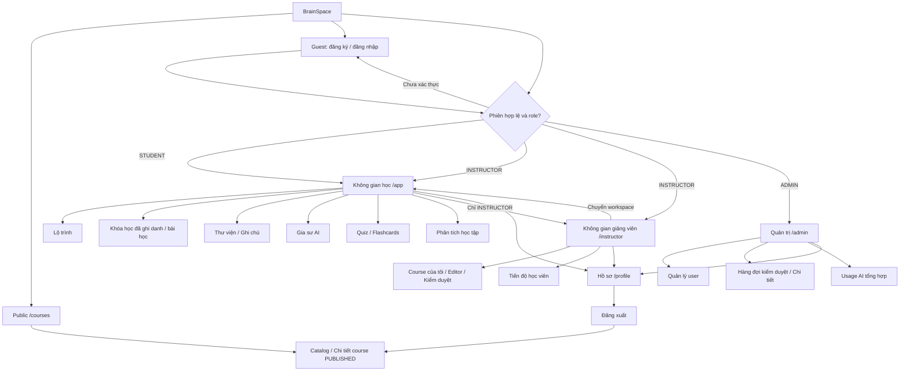
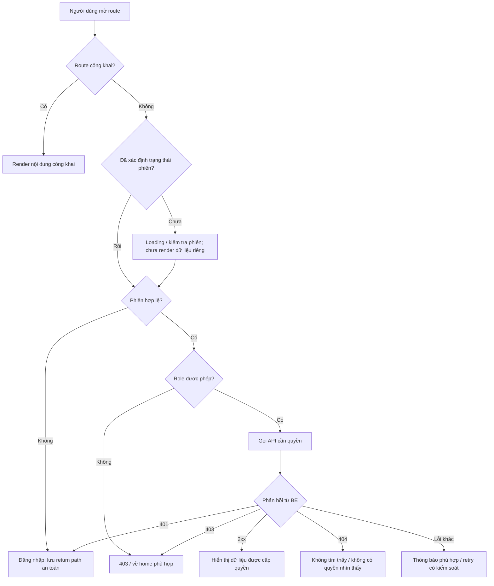
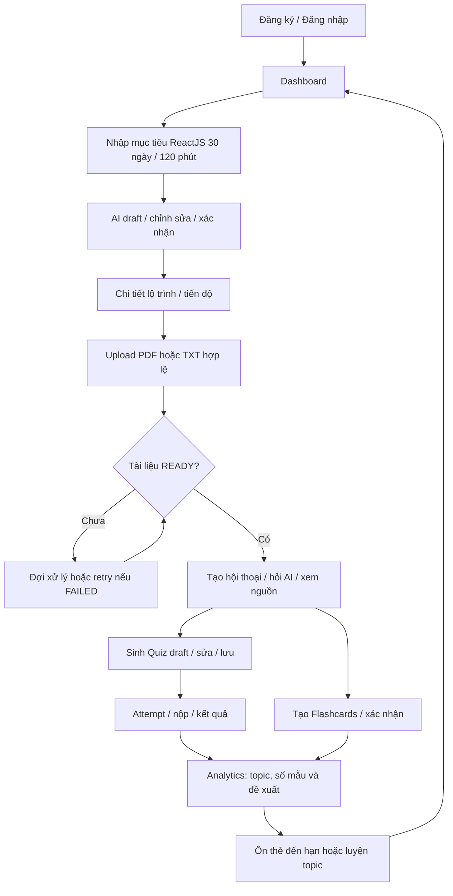
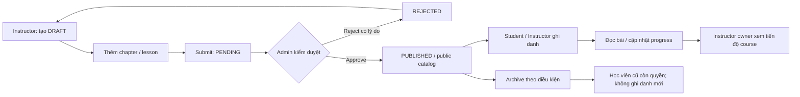

# Thiết kế giao diện và điều hướng — BrainSpace 1.0

**Issue:** [#5 — S0-04](https://github.com/anyl-mely/brainspace/issues/5) · **Milestone:** M1 - Foundation · **Phụ trách:** Dev A (Leader) · **Mã yêu cầu:** `NFR-01` · **Kiểm thử:** `T23`

**Phiên bản thiết kế:** 0.1 — Đề xuất để nhóm review. **Ngày lập:** 28/11/2026. **Baseline:** [`a01942b`](https://github.com/anyl-mely/brainspace/tree/a01942bc76e0b22be17cfbbf92f80cf8a471c874). Đây là tài liệu thiết kế, không phải giao diện đã lập trình, API đang chạy, bản Figma hay kết quả kiểm thử ứng dụng. Các route Frontend (FE), tên màn hình, cách bố trí và dữ liệu mẫu là đề xuất thiết kế; hành vi nghiệp vụ giữ theo đặc tả đã có. API/DTO vẫn phải được xác nhận tại #4. Mã `UI-*` trong tài liệu chỉ là mã truy vết màn hình, khác với mã yêu cầu như `PATH-01`.

## 1. Mục tiêu và phạm vi

Issue #5 xác định cấu trúc thông tin, điều hướng (sitemap), bố cục low-fidelity (wireframe), phân quyền truy cập và trạng thái giao diện trước khi dựng Frontend ở #6. Đầu ra gồm tài liệu này, 13 bảng wireframe SVG (39 cặp màn hình desktop/mobile) và checklist review. Tất cả bảy module P0 đều được bao phủ; không thêm Knowledge Graph, community, leaderboard, notification email/push, marketplace, thanh toán, video streaming, OCR hay app mobile native vào MVP. Catalog công khai nằm trong Course Management, không phải module thứ tám.

| Acceptance Criteria gốc (#5) | Đầu ra thiết kế cần review |
| --- | --- |
| Có sitemap và wireframe cho Student, Instructor, Admin và public catalog. | §2–4, 13 SVG, danh mục màn hình và route. |
| Mỗi luồng chính có list/detail/form/loading/empty/error; desktop/mobile, label và focus keyboard. | §4–6, bảng trạng thái theo luồng, wireframe dùng chung `13-ui-states.svg`, quy tắc accessibility. |
| Cả nhóm review navigation, role guard và luồng demo ReactJS. | §3, §7–9; ghi ý kiến và bằng chứng thật tại Issue/PR. |

## 2. Phân tích người dùng và quyền

Nguồn quyền chính là [Đặc tả chức năng §2](../FUNCTIONAL_SPECIFICATION.md); UI chỉ thể hiện đúng quyền, không phải lớp bảo mật thay cho Backend (BE). Guest là trạng thái chưa đăng nhập, không phải role lưu trong DB. `LEARNER` trong tài liệu là cách gọi nhóm gồm `STUDENT` và `INSTRUCTOR`, không thêm enum vào hệ thống. `AUTHED` gồm ba role đã đăng nhập; `ALL` là mọi actor. Người mới luôn được server gán `STUDENT`.

| Nghiệp vụ | Guest | STUDENT | INSTRUCTOR | ADMIN |
| --- | --- | --- | --- | --- |
| Xem catalog và metadata khóa PUBLISHED | Có | Có | Có | Có |
| Đăng ký/đăng nhập khi chưa xác thực | Có | — | — | — |
| Hồ sơ cá nhân, đổi mật khẩu, đăng xuất | — | Có | Có | Có |
| Path, Library/Notes, Tutor, Quiz, Flashcards, Analytics | — | Tài nguyên của mình | Tài nguyên của mình | — |
| Ghi danh miễn phí và học bài | — | Khi có quyền | Khi có quyền | — |
| Tạo và quản lý khóa học, xem tiến độ học viên | — | — | Course mình sở hữu | — |
| Kiểm duyệt course, quản lý người dùng/role/status | — | — | — | Có |
| Thống kê AI và hệ thống | — | — | — | Chỉ số tổng hợp; không xem nội dung riêng |

**Quy tắc quan trọng:** Instructor không được xem quiz, hội thoại, tài liệu riêng của học viên. Admin chỉ được truy cập metadata/nội dung khóa học trong phạm vi kiểm duyệt; không được mở workspace học tập cá nhân của user khác. Mọi request phải được BE kiểm tra session, role và ownership/enrollment; không lấy identity từ input do client gửi.

## 3. Sitemap và điều hướng

### 3.1. Sitemap cấp hệ thống



Mũi tên là điều hướng, không phải API gọi giữa các module. URL gốc `/` đề xuất dẫn đến catalog; `/instructor` chuyển đến `/instructor/courses` cho Instructor; `/app` và `/admin` là home theo role. Không tự chuyển Admin sang learner workspace. `/profile` dùng chung cho các role đã xác thực. Route `/courses/:courseId` là public detail của course PUBLISHED, trong khi editor và moderation có route riêng, không trộn quyền.

### 3.2. Layout dùng chung và navigation theo actor

| Layout | Điều hướng desktop | Mobile | Ghi chú |
| --- | --- | --- | --- |
| PublicLayout | Logo, Catalog, Đăng nhập/Đăng ký (Guest) hoặc tài khoản (đã đăng nhập) | Header và menu thu gọn | Không đòi login để đọc catalog PUBLISHED. |
| LearnerLayout | Sidebar: Dashboard, Lộ trình, Khóa học, Thư viện, Ghi chú, Gia sư AI, Quiz, Flashcards, Phân tích, Hồ sơ | Nút menu mở navigation; nội dung một cột | Instructor có thêm lối chuyển sang workspace giảng viên (mục Giảng viên (*) trong wireframe chỉ xuất hiện với INSTRUCTOR). |
| InstructorLayout | Course của tôi, Tạo course, chuyển workspace học, Hồ sơ | Menu thu gọn; editor xếp theo từng nhóm | Student/Admin không được mở workspace này. |
| AdminLayout | Tổng quan, Người dùng, Kiểm duyệt, Hồ sơ | Menu thu gọn; bảng thành danh sách card | Không có menu Library/Tutor/Quiz của user. |
| ProfileLayout | Hồ sơ và đổi mật khẩu, quay về home đúng role | Form một cột | Logout dùng action của server; sau thành công dọn cache riêng tư. |

### 3.3. Route guard — hợp đồng đề xuất cho #6 và #10



- Guest truy cập protected route → `/login`, lưu đường dẫn nội bộ hợp lệ (không nhận URL bên ngoài); sau login kiểm tra lại quyền route, nếu không phù hợp chuyển home theo role. User đã đăng nhập mở `/login` hoặc `/register` → home đúng role.
- FE sử dụng auth trạng thái `checking/authenticated/unauthenticated` (tên đề xuất, không phải enum API). Không hiển thị màn hình protected thoáng qua khi chưa kiểm tra xong. Khi refresh cookie không còn hợp lệ, logout/xóa dữ liệu cache cá nhân và thông báo đăng nhập lại; refresh có giới hạn, tránh vòng lặp. Cách lưu session/refresh/access token triển khai theo [Implementation Guide §5](../IMPLEMENTATION_GUIDE.md), chốt tại #4/#10.
- 401: chưa xác thực/hết phiên; 403: sai role hoặc hành động bị từ chối; 404: tài nguyên không tồn tại hoặc caller không có quyền nhìn thấy tài nguyên riêng tư. Không tiết lộ rằng dữ liệu của user khác tồn tại. Nút bị ẩn/disabled không thể thay cho BE authorization.
- Khi đổi tài khoản, logout hoặc bị khóa, xóa/invalidate query cache chứa dữ liệu riêng tư; các query key cần gắn phạm vi identity. Link trực tiếp/reload route lồng nhau phải được kiểm tra ở #12 và M5.

## 4. Danh mục màn hình và wireframe

Wireframe **low-fidelity** sử dụng cấu trúc, nhãn, thứ bậc và hành động để thống nhất nghiệp vụ; không chốt bộ màu/typography hoặc component production. Mỗi SVG hiển thị cùng một màn hình ở desktop và mobile. Mở file gốc để zoom; các cặp màn hình không phải ảnh chụp ứng dụng đang chạy. Hành động gom chung trong một khối (ví dụ Xem/Sửa/Xóa) sẽ được tách thành các control thực khi lập trình. Số liệu ReactJS, tên user và nội dung mẫu là giả lập. Các route là đề xuất FE, **không phải** tên endpoint REST; những hành vi API chưa được chốt ghi ở §8. Các form/detail cùng route có thể dùng page con, dialog hoặc chế độ edit sau khi #6 review.

[Danh mục đầy đủ các SVG](wireframes/README.md).

### 01 — Catalog công khai và xác thực

[**Mở wireframe desktop/mobile (SVG)**](wireframes/01-public-auth.svg).

| Screen ID / Màn hình | Route Frontend đề xuất | Actor | Truy vết yêu cầu | Quy tắc / điều kiện bàn giao |
| --- | --- | --- | --- | --- |
| UI-PUB-01 — Catalog khóa học | `/courses` | Công khai / mọi actor | COURSE-01 | Chỉ hiển thị PUBLISHED; phân trang từ server; empty khi không có kết quả. Guest có thể xem mà không đăng nhập. |
| UI-PUB-02 — Chi tiết khóa học | `/courses/:courseId` | Công khai / mọi actor | COURSE-01/05 | Không đưa nội dung lesson riêng vào metadata công khai; danh sách metadata chương/bài cần #4 xác nhận. Admin không ghi danh; khóa archived không có ghi danh mới. |
| UI-AUTH-01 — Đăng ký | `/register` | Guest | AUTH-01 | Không có chọn role. Label thực, lỗi theo trường; giới hạn mật khẩu theo BR-01. |
| UI-AUTH-02 — Đăng nhập | `/login` | Guest | AUTH-02/06 | Phiên hợp lệ mới chuyển tới home theo role hoặc return path hợp lệ; khi logout xóa cache riêng tư. |

### 02 — Không gian cá nhân và hồ sơ

[**Mở wireframe desktop/mobile (SVG)**](wireframes/02-dashboard-profile.svg).

| Screen ID / Màn hình | Route Frontend đề xuất | Actor | Truy vết yêu cầu | Quy tắc / điều kiện bàn giao |
| --- | --- | --- | --- | --- |
| UI-HOME-01 — Dashboard học tập | `/app` | STUDENT / INSTRUCTOR | ANA-01/04; FLASH-03 | Các số chỉ là dữ liệu wireframe; Dashboard thật lấy từ API, không giả lập kết quả như dữ liệu thật. |
| UI-USER-01 — Hồ sơ và mật khẩu | `/profile` | STUDENT / INSTRUCTOR / ADMIN | AUTH-03/04 | Không có chỉnh role/status trong form. Đổi mật khẩu thu hồi phiên theo chính sách; hướng dẫn đăng nhập lại. |

### 03 — Lộ trình học tập

[**Mở wireframe desktop/mobile (SVG)**](wireframes/03-learning-path.svg).

| Screen ID / Màn hình | Route Frontend đề xuất | Actor | Truy vết yêu cầu | Quy tắc / điều kiện bàn giao |
| --- | --- | --- | --- | --- |
| UI-PATH-01 — Danh sách lộ trình | `/app/paths` | STUDENT / INSTRUCTOR | PATH-01/05 | Tất cả tài nguyên theo owner; xác nhận xóa, giữ filter khi quay lại. |
| UI-PATH-02 — Form tạo / sửa lộ trình | `/app/paths/new` · `/app/paths/:pathId/edit` | STUDENT / INSTRUCTOR | PATH-01/02; BR-02 | Không tự lưu khi chọn AI; kiểm tra title, độ dài, giới hạn theo BR-02. |
| UI-PATH-03 — Xem và sửa bản nháp AI | `/app/paths/new (bước preview)` | STUDENT / INSTRUCTOR | PATH-02/03; NFR-05 | Dùng draft local trong form; xác nhận lưu path + items nguyên tử theo contract #4, không tự lưu bản nháp. |
| UI-PATH-04 — Chi tiết và tiến độ | `/app/paths/:pathId` | STUDENT / INSTRUCTOR | PATH-03/04; BR-09/10 | Số % do server tính; topic dùng ID thống nhất; reorder/confirm API chờ #4 chốt; không tự tạo endpoint. |

### 04 — Ghi danh và học khóa học

[**Mở wireframe desktop/mobile (SVG)**](wireframes/04-course-learning.svg).

| Screen ID / Màn hình | Route Frontend đề xuất | Actor | Truy vết yêu cầu | Quy tắc / điều kiện bàn giao |
| --- | --- | --- | --- | --- |
| UI-LEARN-01 — Khóa học đã ghi danh | `/app/enrollments` | STUDENT / INSTRUCTOR | COURSE-05/06 | Khóa đã archive: học viên cũ vẫn đọc nếu có quyền. Không đăng ký trùng. |
| UI-LEARN-02 — Bài học và tiến độ | `/app/courses/:courseId/lessons/:lessonId` | STUDENT / INSTRUCTOR | COURSE-05/06 | Backend kiểm tra enrollment, owner/course và lesson. 403 sai role; 404 tài nguyên không có quyền nhìn thấy. |

### 05 — Thư viện kiến thức

[**Mở wireframe desktop/mobile (SVG)**](wireframes/05-knowledge-library.svg).

| Screen ID / Màn hình | Route Frontend đề xuất | Actor | Truy vết yêu cầu | Quy tắc / điều kiện bàn giao |
| --- | --- | --- | --- | --- |
| UI-LIB-01 — Danh sách tài liệu | `/app/library` | STUDENT / INSTRUCTOR | LIB-02/04 | Chỉ list của owner; trạng thái do server trả; filter rõ khi không có kết quả. |
| UI-LIB-02 — Tải tài liệu lên | `/app/library/upload` | STUDENT / INSTRUCTOR | LIB-01/06; BR-05 | Giới hạn phải được BE kiểm tra. Trạng thái trả ngay sau upload/201–202 chờ #4; không tự hiển thị READY. |
| UI-LIB-03 — Chi tiết, sửa và xử lý | `/app/library/:documentId` | STUDENT / INSTRUCTOR | LIB-02/03/06 | Xóa chặn retrieval ngay; giữ tài nguyên phát sinh theo BR-06, nguồn mất được đánh dấu; không public URL. |
| UI-LIB-04 — Quản lý tag | `/app/library/tags` | STUDENT / INSTRUCTOR | LIB-04; API tags | Tag cá nhân; hành vi chi tiết khi xóa tag chốt tại #4 và #22 (CORE-10). |

### 06 — Ghi chú cá nhân

[**Mở wireframe desktop/mobile (SVG)**](wireframes/06-notes.svg).

| Screen ID / Màn hình | Route Frontend đề xuất | Actor | Truy vết yêu cầu | Quy tắc / điều kiện bàn giao |
| --- | --- | --- | --- | --- |
| UI-NOTE-01 — Danh sách ghi chú | `/app/notes` | STUDENT / INSTRUCTOR | LIB-05 | Không lộ ghi chú tài khoản khác. Tìm kiếm là phương án UI, chốt #4 nếu cần. |
| UI-NOTE-02 — Chi tiết / biên tập ghi chú | `/app/notes/new` · `/app/notes/:noteId` | STUDENT / INSTRUCTOR | LIB-05; BR-06 | Tài liệu liên kết phải của owner; preview đã sanitize; thay đổi chưa lưu có xác nhận khi rời trang. |

### 07 — Gia sư AI có trích dẫn

[**Mở wireframe desktop/mobile (SVG)**](wireframes/07-ai-tutor.svg).

| Screen ID / Màn hình | Route Frontend đề xuất | Actor | Truy vết yêu cầu | Quy tắc / điều kiện bàn giao |
| --- | --- | --- | --- | --- |
| UI-TUTOR-01 — Danh sách và tạo hội thoại | `/app/tutor` | STUDENT / INSTRUCTOR | AI-01/04 | Một hội thoại chọn đúng một tài liệu READY thuộc owner. Không cho chọn tài liệu PROCESSING/FAILED. |
| UI-TUTOR-02 — Hỏi đáp và nguồn | `/app/tutor/:conversationId` | STUDENT / INSTRUCTOR | AI-02/03/04/05; NFR-05 | Không bịa citation; TXT không gán trang giả; xóa tài liệu thì chặn retrieval. Không hiển thị trả lời giả thành công. |

### 08 — Quiz: tạo, luyện tập và kết quả

[**Mở wireframe desktop/mobile (SVG)**](wireframes/08-quiz.svg).

| Screen ID / Màn hình | Route Frontend đề xuất | Actor | Truy vết yêu cầu | Quy tắc / điều kiện bàn giao |
| --- | --- | --- | --- | --- |
| UI-QUIZ-01 — Danh sách Quiz | `/app/quizzes` | STUDENT / INSTRUCTOR | QUIZ-01/02/04 | Chỉ Quiz cá nhân; chỉ draft AI đã xác nhận mới xuất hiện ở danh sách. |
| UI-QUIZ-02 — Trình biên tập Quiz | `/app/quizzes/new` · `/app/quizzes/:quizId/edit` | STUDENT / INSTRUCTOR | QUIZ-01/02; BR-07 | AI preview trước lưu; validate schema/topic/nguồn; không lưu dở dang. Editor được xem đáp án, player không. |
| UI-QUIZ-03 — Màn hình làm bài | `/app/quiz-attempts/:attemptId` | STUDENT / INSTRUCTOR | QUIZ-03; BR-07 | Player DTO không có đáp án hay lời giải. Khóa double submit; server chấm và ghi một lần, không nhận điểm client. |
| UI-QUIZ-04 — Kết quả và lịch sử | `/app/quiz-attempts` · `/app/quiz-attempts/:attemptId/result` | STUDENT / INSTRUCTOR | QUIZ-04; ANA-02 | Snapshot và kết quả cũ không đổi khi Quiz gốc sửa/xóa; route kết quả chỉ sau trạng thái đã nộp. |

### 09 — Flashcards và ôn tập cách quãng

[**Mở wireframe desktop/mobile (SVG)**](wireframes/09-flashcards.svg).

| Screen ID / Màn hình | Route Frontend đề xuất | Actor | Truy vết yêu cầu | Quy tắc / điều kiện bàn giao |
| --- | --- | --- | --- | --- |
| UI-FLASH-01 — Danh sách bộ thẻ | `/app/flashcards` | STUDENT / INSTRUCTOR | FLASH-01/03 | Due cards từ server theo owner, sắp theo due_at; không tự tính số đến hạn trên FE. |
| UI-FLASH-02 — Chi tiết / biên tập bộ thẻ | `/app/flashcards/new` · `/app/flashcards/:deckId` | STUDENT / INSTRUCTOR | FLASH-01; BR-08/10 | Có thể chỉnh AI draft trước lưu; dùng topic ID owner; xác nhận xóa. |
| UI-FLASH-03 — Phiên ôn thẻ | `/app/flashcards/review` | STUDENT / INSTRUCTOR | FLASH-02/03; BR-08 | Chỉ hiện nút rating sau khi lật; server quyết định due_at. Request key ổn định cho retry, khóa double click. |

### 10 — Phân tích học tập

[**Mở wireframe desktop/mobile (SVG)**](wireframes/10-analytics.svg).

| Screen ID / Màn hình | Route Frontend đề xuất | Actor | Truy vết yêu cầu | Quy tắc / điều kiện bàn giao |
| --- | --- | --- | --- | --- |
| UI-ANA-01 — Phân tích và đề xuất ôn tập | `/app/analytics` | STUDENT / INSTRUCTOR | ANA-01/02/03/04; BR-09 | Dưới 5 câu không gắn nhãn điểm yếu; accuracy null khi 0; >=5 mẫu áp dụng ngưỡng BR-09; không tạo số liệu bằng AI. |

### 11 — Không gian giảng viên

[**Mở wireframe desktop/mobile (SVG)**](wireframes/11-instructor.svg).

| Screen ID / Màn hình | Route Frontend đề xuất | Actor | Truy vết yêu cầu | Quy tắc / điều kiện bàn giao |
| --- | --- | --- | --- | --- |
| UI-INS-01 — Khóa học của giảng viên | `/instructor/courses` | INSTRUCTOR | COURSE-02/04 | Chỉ owner; PUBLISHED cần reopen draft và xác nhận tạm ẩn; course đã có enrollment không hard-delete. |
| UI-INS-02 — Biên tập khóa học | `/instructor/courses/new` · `/instructor/courses/:courseId/edit` | INSTRUCTOR | COURSE-02/03 | Chỉ edit khi trạng thái cho phép; không thực thi HTML; reorder contract cần #4 thống nhất. |
| UI-INS-03 — Chi tiết và gửi kiểm duyệt | `/instructor/courses/:courseId` | INSTRUCTOR | COURSE-02/04; BR-03/04 | Không tự approve; PENDING khóa sửa; archive chặn ghi danh mới nhưng giữ quyền học viên cũ; server kiểm tra transition. |
| UI-INS-04 — Tiến độ học viên | `/instructor/courses/:courseId/students` | INSTRUCTOR | COURSE-07 | Không công khai email; không có truy cập dữ liệu học tập cá nhân ngoài tiến độ course được phép. |

### 12 — Không gian quản trị

[**Mở wireframe desktop/mobile (SVG)**](wireframes/12-admin.svg).

| Screen ID / Màn hình | Route Frontend đề xuất | Actor | Truy vết yêu cầu | Quy tắc / điều kiện bàn giao |
| --- | --- | --- | --- | --- |
| UI-ADM-01 — Quản lý người dùng | `/admin/users` | ADMIN | AUTH-05/06; BR-13 | Server whitelist role/status, thu hồi phiên khi khóa; không cho self downgrade/last admin lock; không có mật khẩu/hash. |
| UI-ADM-02 — Hàng đợi kiểm duyệt | `/admin/courses` | ADMIN | COURSE-04 | Chỉ chức năng moderation; không thao tác như học viên hay chỉnh nội dung khóa học thay giảng viên. |
| UI-ADM-03 — Chi tiết kiểm duyệt | `/admin/courses/:courseId` | ADMIN | COURSE-04; BR-03 | Chỉ transition hợp lệ; ghi lý do, không tự động approve. Có quyền xem lesson trong phạm vi kiểm duyệt. |
| UI-ADM-04 — Thống kê quản trị | `/admin` | ADMIN | AUTH-05; quyền Admin §2 | Chỉ số tổng hợp theo API /admin/analytics; dữ liệu mẫu không phải kết quả đo thật. |

### 13 — Trạng thái dùng chung và khả năng truy cập

[**Mở wireframe desktop/mobile (SVG)**](wireframes/13-ui-states.svg).

| Screen ID / Màn hình | Route Frontend đề xuất | Actor | Truy vết yêu cầu | Quy tắc / điều kiện bàn giao |
| --- | --- | --- | --- | --- |
| UI-STATE-01 — Loading và Empty | Áp dụng các list/detail | Công khai / mọi actor | NFR-01/02; T23 | Đây là hai biến thể riêng, không xuất hiện cùng lúc; empty không được giả làm loading/error. |
| UI-STATE-02 — Lỗi form và thử lại | Áp dụng các form/mutation | Công khai / mọi actor | NFR-01/02; T23 | Biến thể error/success riêng; disabled khi đang gửi, báo trạng thái cho screen reader; retry theo tính idempotent. |
| UI-STATE-03 — Phiên và quyền truy cập | Áp dụng các route protected | Công khai / mọi actor | AUTH-06; NFR-03 | Các panel là biến thể độc lập; không render dữ liệu riêng trong khi kiểm tra session; BE mới là nguồn quyền. |

## 5. Trạng thái giao diện theo từng luồng chính

List/detail/form và các trạng thái khác được thiết kế theo cùng pattern trên desktop và mobile. Bảng dưới đây làm rõ biến thể dùng ở từng module (wireframe `13-ui-states.svg` minh họa chung; không cần nhân bản toàn bộ sheet cho mọi tình huống). Từng trường nhập phải có label thật, thông báo lỗi gắn đúng trường và giá trị được giữ khi lỗi có thể phục hồi.

| Luồng / Screen ID | List / Detail / Form | Loading | Empty | Error | Success / tiếp theo |
| --- | --- | --- | --- | --- | --- |
| Public / AUTH (`UI-PUB-*`, `UI-AUTH-*`) | Catalog, course detail, form đăng ký/login | Skeleton catalog/detail; đang gửi form | Không có khóa học / xóa filter | 409 email trùng; 401 sai thông tin; 429; 404 khóa không công khai | Đăng ký thành công → login; login → home hoặc return path hợp lệ |
| Profile (`UI-USER-01`) | Xem hồ sơ / edit / đổi mật khẩu | Chờ dữ liệu; khóa submit lặp | Placeholder avatar, trường tùy chọn trống | Lỗi trường / mật khẩu sai / phiên hết hạn | Toast hoặc status, reload dữ liệu; đổi mật khẩu theo quy tắc phiên |
| Path (`UI-PATH-*`) | List / detail / edit / AI draft / item form | Skeleton, sinh AI draft, lưu item | Tạo path; path chưa có item | 400, 404 owner, 429/timeout/JSON sai; giữ form | Xác nhận draft; hiển thị path và tiến độ từ server |
| Course (`UI-PUB-*`, `UI-LEARN-*`) | Catalog / detail / enroll confirmation / lesson | Tải list, bài, ghi danh / progress pending | Không có course đã ghi danh | 403 sai quyền, 404, conflict enrollment/state | Ghi danh một lần; xem bài, cập nhật/hoàn tác progress |
| Library (`UI-LIB-*`) | List / detail / upload / edit metadata/tag | Upload pending, PROCESSING, tải trích xuất | Upload tài liệu; không khớp filter | File không hợp lệ, PDF scan, FAILED, 404, retry có kiểm soát | Theo dõi UPLOADED/PROCESSING; chỉ READY mới mở Tutor/generate |
| Notes (`UI-NOTE-*`) | List / detail / editor | Tải và lưu Markdown | Tạo ghi chú | Lỗi title/owner/link, network; nội dung chưa lưu | Lưu và hiển thị preview an toàn |
| Tutor (`UI-TUTOR-*`) | List / form hội thoại / chi tiết chat | Đang lấy lịch sử / gửi câu hỏi | Chưa có hội thoại hoặc document READY | Thiếu căn cứ, nguồn mất, quota, provider timeout; không giả success | Hiển thị answer và nguồn được xác thực; giữ câu hỏi để retry nếu hợp lệ |
| Quiz (`UI-QUIZ-*`) | List / editor / attempt / result-history | Sinh draft, khởi tạo attempt, chờ chấm | Chưa có Quiz / chưa làm bài | Draft sai, timeout, 404, nộp lặp, conflict | Lưu draft đã confirm; server trả kết quả sau submit, luyện lại bằng attempt mới |
| Flashcards (`UI-FLASH-*`) | Deck list / editor / review | Tải thẻ/sinh draft/lưu review | Chưa có deck / không có due cards | Lỗi schema, network, owner, rating sai; không nhân đôi review | Lưu deck; lật/rate, hiển thị thẻ tiếp theo hoặc hết thẻ |
| Dashboard / Analytics (`UI-HOME-01`, `UI-ANA-01`) | Tổng hợp / topic detail trong trang / form lọc ngày | Skeleton metrics; thay filter | Chưa có dữ liệu; null accuracy; ít hơn 5 mẫu ghi rõ | Lỗi mạng, request không hợp lệ | Cập nhật metrics server và liên kết đề xuất có thật |
| Instructor (`UI-INS-*`) | Course list / detail / editor / moderation submit / student list | Tải, lưu, submit, đổi trạng thái | Chưa có course hoặc học viên | Không đủ lesson, sai owner, conflict/transition sai | Lưu DRAFT, PENDING khóa sửa, hiển thị trạng thái/lý do từ server |
| Admin (`UI-ADM-*`) | User list/detail edit tại hàng/dialog; moderation list/detail/form; usage tổng hợp | Loading danh sách, quyết định, mutation | Không có kết quả / không có course chờ duyệt | 403, 404, validation, không được khóa admin cuối, conflict state | Refresh danh sách và thông báo quyết định đã lưu |

### 5.1. Nguyên tắc form và lỗi

- Label hiển thị liên tục (không dùng placeholder thay label), trường bắt buộc có chữ hoặc dấu kèm giải thích. Dùng validation FE để hỗ trợ UX; BE vẫn là nơi quyết định dữ liệu hợp lệ. Ánh xạ `error.details[].field` nếu có theo hợp đồng #4; giữ dữ liệu người dùng, trừ trường nhạy cảm cần xóa theo chính sách. Không lộ stack trace, secret hay raw provider error; `requestId` dùng khi hỗ trợ nếu phù hợp.
- Pending: khóa nút submit hoặc action đang gửi, giữ nhãn có thể hiểu được. Loading và empty không thay thế lẫn nhau; khi retry cần kiểm tra mutation idempotency. Quiz submit và Flashcard review dùng cơ chế của server; không tự chấm hoặc ghi hai lần. Mutation thành công invalidate/refetch query liên quan.
- Xóa, archive, reopen draft, khóa user và moderation cần xác nhận, mô tả tác động; cancel giữ dữ liệu. Hành vi khi dữ liệu đã thay đổi xử lý conflict/refresh, không âm thầm overwrite. Form chưa lưu cần cảnh báo trước khi rời trang nếu có nguy cơ mất nội dung.
- Các trạng thái AI/document: UPLOADED, PROCESSING, READY, FAILED theo đặc tả; không giả định upload lập tức READY. Tách nguồn mất, thiếu căn cứ, quota 429 và lỗi provider; dữ liệu gửi provider phải có quyền sử dụng.

## 6. Responsive và khả năng truy cập (NFR-01 / T23)

Các mốc viewport dưới đây là **đề xuất thiết kế** để #6 triển khai và thử lại; không phải breakpoint đã quyết định trong mã nguồn.

| Kích thước kiểm tra đề xuất | Bố cục |
| --- | --- |
| 360–390 px (mobile) | Header/menu thu gọn, một cột; list dạng card, filter xếp gọn, input/action full-width khi phù hợp; chat và form không mất CTA, không cuộn ngang toàn trang. |
| 768 px (tablet) | Menu thu gọn hoặc sidebar tùy không gian, grid linh hoạt; không ẩn thông tin bắt buộc. |
| 1280–1440 px (desktop) | Sidebar + main content; list có thể dùng table; editor/detail chia vùng nội dung; chat có lịch sử và nội dung/nguồn. |

1. Dùng heading có thứ tự, `main`, `nav`, form semantic; `label` liên kết với input, lỗi gắn `aria-describedby`/`aria-invalid` khi thích hợp. Control dùng được bằng bàn phím, không dùng div click-only. Các thao tác icon phải có accessible name; trạng thái không chỉ phân biệt bằng màu.
2. Thứ tự Tab theo DOM/luồng nhìn; focus nhìn thấy rõ, không bị sticky header che. Khi submit có lỗi, focus lỗi đầu tiên hoặc error summary; khi route đổi, chuyển focus hợp lý đến heading. Khi mở dialog/menu, quản lý focus, Escape đóng khi thích hợp và trả focus về trigger. Không giữ keyboard trap ngoài dialog modal.
3. Đề xuất target thao tác mobile khoảng 44 px khi phù hợp; tách các hành động nguy hiểm khỏi nút chính; form hỗ trợ zoom, text wrap, label không bị cắt. Wireframe không phải kích thước CSS cuối cùng, các khối action gom nhiều nút chỉ biểu diễn nhóm hành động.
4. Loading/success/error dùng status hoặc live region phù hợp, không tự chuyển focus mỗi lần polling; quiz radio có group/legend, Flashcard lật bằng nút có nhãn, kết quả đúng/sai có chữ. Cần kiểm tra contrast và focus thực tế khi xây dựng theme/component.
5. Kiểm tra 360/390/768/1280 px, keyboard-only (Tab/Shift+Tab/Enter/Space/Escape), zoom, lỗi form, mạng lỗi, trạng thái rỗng, session hết hạn và truy cập route sai quyền. **T23 ở ứng dụng: NOT RUN** vì #5 chỉ thiết kế; phải thực hiện thật khi UI đã được xây dựng. Không tuyên bố đạt WCAG hoặc test bảo mật chỉ từ hình SVG.

## 7. Luồng demo ReactJS và luồng quản trị

### 7.1. Luồng chính — học, luyện tập và ôn tập

Dữ liệu minh họa: Student demo, mục tiêu ReactJS từ cơ bản, 30 ngày, 120 phút/ngày, PDF/TXT có quyền sử dụng. Không đưa email thật, token hoặc tài liệu học tập riêng vào repository. Các số liệu trong ví dụ chỉ phục vụ review thiết kế, không phải kết quả chạy AI.



| Bước | Màn hình | Kiểm chứng mong đợi ở bản chạy được |
| --- | --- | --- |
| 1 | UI-AUTH-01/02 → UI-HOME-01 | Đăng ký role STUDENT, phiên hợp lệ, dashboard không lộ dữ liệu của người khác. |
| 2 | UI-PATH-02/03/04 | Draft chỉnh sửa được; confirm mới lưu; hoàn thành item làm cập nhật progress. |
| 3 | UI-LIB-02/03 | File hợp lệ private, trạng thái đúng; PDF scan báo không hỗ trợ; READY mới được dùng. |
| 4 | UI-TUTOR-01/02 | Chọn đúng một tài liệu, trả lời có nguồn thực; thiếu ngữ cảnh báo rõ. |
| 5 | UI-QUIZ-02/03/04 | Draft validate trước lưu; player không lộ đáp án; server chấm đúng một lần. |
| 6 | UI-ANA-01 | Topic có số mẫu; ít hơn 5 câu chưa đủ dữ liệu. Ví dụ 3/5 = 60% chỉ là minh họa. |
| 7 | UI-FLASH-02/03 → UI-HOME-01 | Tạo deck/card, due cards từ server, rating cập nhật lịch ôn; không lưu trùng. |

Theo BR-09, khi có ít nhất 5 câu đã trả lời trong topic: accuracy dưới 60% → củng cố; từ 60% đến dưới 80% → luyện thêm; từ 80% trở lên → kết quả tốt. Khi chưa có mẫu, accuracy là null; dưới 5 mẫu hiển thị chưa đủ dữ liệu.

Luồng lỗi khi AI không hoạt động: cho tạo Path/Quiz/Flashcards thủ công; không ghi bản nháp AI dở dang, không giả kết quả. Không dùng AI để chấm điểm hay sinh số liệu analytics.

### 7.2. Luồng Instructor / Admin / Student



Kiểm tra trực tiếp route khác role và dữ liệu owner khác; không xem chức năng Admin chỉ bằng việc ẩn menu. Instructor không tự approve course. Khi muốn sửa PUBLISHED phải xác nhận việc chuyển về DRAFT, tạm ẩn và kiểm duyệt lại. Course đã có enrollment không hard-delete. Luồng này là demo phụ, không thay thế luồng học tập AI chính.

## 8. Bàn giao kỹ thuật cho các Issue tiếp theo

| Issue / Owner | Đầu ra cần nhận hoặc phối hợp | Không tự quyết định trong #5 |
| --- | --- | --- |
| [#3 — Dev C](https://github.com/anyl-mely/brainspace/issues/3) | Entity/ownership, Topic ID, course/enrollment, path items, snapshot, due_at | Schema, unique, migration, vector dimension do #3/#8 xác nhận. |
| [#4 — Dev B](https://github.com/anyl-mely/brainspace/issues/4) | API contract và error DTO, pagination, role, nullability, mock payload, state transition | Route FE không tạo endpoint BE mới. Cần xác nhận reorder/confirm path và chapter/lesson, upload status ngay sau request (201/202, UPLOADED/PROCESSING), filter/search được hỗ trợ, tag deletion, payload progress và moderation. |
| [#6 — Dev A](https://github.com/anyl-mely/brainspace/issues/6) | Layout, navigation, route table, common components, mock contract và data client | Dựng React + TS/Vite/Router/Tailwind theo version pin; chưa coi mock là backend thật. |
| [#7 — Dev B](https://github.com/anyl-mely/brainspace/issues/7) | Health/API base và contract lỗi/validation | BE thực thi quyền, không tin role/owner client. |
| [#8 — Dev B](https://github.com/anyl-mely/brainspace/issues/8) | Provider/model, quota và timeout; dữ liệu hợp lệ | Không chốt quota/dimension/provider từ hình UI; hiển thị lỗi dựa trên API thật. |
| [#10 — Dev A](https://github.com/anyl-mely/brainspace/issues/10) | Identity/session/guard FE và BE | Chưa coi auth skeleton là login hoàn chỉnh; #13 làm session thật. |
| [#11](https://github.com/anyl-mely/brainspace/issues/11), [#12](https://github.com/anyl-mely/brainspace/issues/12) | CI checks, kiểm tra route reload/deployment | Bật required checks sau CI chạy thành công; chưa có bằng chứng build hoặc deploy ở #5. |

API tham chiếu theo [API Specification](API_SPECIFICATION.md), base `/api/v1`; các endpoint dưới đây là **contract dự thảo hiện có**, không phải URL FE mới hay API đã chạy. FE adapters/tên DTO cần #4 chốt.

| Màn hình / module | Nhóm endpoint hiện có (rút gọn, bỏ base `/api/v1`) |
| --- | --- |
| Auth / profile | `/auth/register`, `/auth/login`, `/auth/refresh`, `/auth/logout`, `/users/me`, `/users/me/change-password` |
| Course public và học | `/courses`, `/courses/:id`, `/courses/:id/enroll`, `/enrollments/me`, `/lessons/:id`, `/lessons/:id/progress` |
| Path | `/learning-paths`, `/learning-paths/:id`, `/learning-paths/generate`, `/learning-paths/:id/items`, `/learning-path-items/:id` |
| Library / Notes | `/documents`, `/documents/:id`, `/documents/:id/download`, `/documents/:id/retry`, `/tags`, `/tags/:id`, `/notes`, `/notes/:id` |
| Tutor | `/conversations`, `/conversations/:id`, `/conversations/:id/messages` |
| Quiz | `/quizzes`, `/quizzes/generate`, `/quizzes/:id`, `/quizzes/:id/attempts`, `/quiz-attempts/:id`, `/quiz-attempts/:id/submit`, `/quiz-attempts` |
| Flashcards | `/flashcard-decks`, `/flashcard-decks/generate`, `/flashcard-decks/:id`, `/flashcard-decks/:id/cards`, `/flashcards/:id`, `/flashcards/due`, `/flashcards/:id/reviews` |
| Learner analytics | `/analytics/overview`, `/analytics/topics`, `/analytics/recommendations` |
| Instructor | `/instructor/courses`, `/courses`, `/courses/:id`, `/courses/:id/chapters`, `/chapters/:id`, `/chapters/:id/lessons`, `/lessons/:id`, `/courses/:id/submit`, `/courses/:id/reopen-draft`, `/courses/:id/archive`, `/courses/:id/students/progress` |
| Admin | `/admin/users`, `/admin/users/:id`, `/admin/courses`, `/admin/courses/:id/status`, `/admin/analytics` |

**Phân chia component đề xuất cho #6:** `PublicLayout`, `LearnerLayout`, `InstructorLayout`, `AdminLayout`, `AuthGuard`, `RoleGuard`, `PageHeader`, `ResponsiveList`, `SearchFilters`, `FormField`, `Pagination`, `LoadingState`, `EmptyState`, `ErrorState`, `ConfirmDialog`, `StatusBadge`. Đây là tên định hướng, không phải component đã có. Các module tổ chức theo features như Implementation Guide; data server qua query hooks và API client chung, không hard-code nghiệp vụ trong component.

## 9. Review, kiểm thử thiết kế và nghiệm thu Issue #5

### 9.1. Checklist dành cho người review

| Mã review | Nội dung | Bằng chứng phải ghi nhận | Trạng thái lúc lập |
| --- | --- | --- | --- |
| UI-R01 | Sitemap/route bao phủ 4 actor và 7 module P0 | Đối chiếu §2–4 với Functional Specification và wireframe | Chờ nhóm review |
| UI-R02 | Guard đúng role/ownership; Admin không học như learner | Review §2/3 và các route direct/401/403/404 | Chờ nhóm review |
| UI-R03 | Desktop/mobile, list/detail/form, loading/empty/error/success | Review 13 SVG và §5–6; mở hình ở GitHub, không crop chữ | Chờ nhóm review |
| UI-R04 | Demo ReactJS đầy đủ, AI draft/READY/citation/quiz/flash/analytics | Walkthrough theo §7; ghi nhận điểm chưa rõ | Chờ nhóm review |
| UI-R05 | Hợp đồng FE và API dự thảo không bị nhầm | Dev B review §8, Dev C review data/owner; ghi câu hỏi #3/#4 | Chờ nhóm review |
| T23 | Responsive, keyboard, validation và lỗi mạng trên ứng dụng | Chạy ứng dụng thực tế, ghi môi trường/commit, expected/actual | NOT RUN — chưa có UI chạy được |

Đề xuất Dev B review Library/AI/API; Dev C review Learning Path, Quiz, Flashcards, Analytics, course enrollment và owner/data; Dev A tổng hợp role guard, UX, navigation và phản hồi. Nếu chưa thể review độc lập, ghi rõ pending, không đánh dấu AC3 chỉ vì một tài khoản khác approve PR. Dùng [GIT_WORKFLOW.md](GIT_WORKFLOW.md) và [CONTRIBUTING.md](../CONTRIBUTING.md).

### 9.2. Acceptance Criteria và DoD

Các checkbox bên dưới là checklist review **chưa đánh dấu**, không phản ánh tự động trạng thái Issue. Cập nhật bằng bằng chứng thực tế trên GitHub; tránh nhiều nguồn trạng thái.

- [ ] AC1: Sitemap và wireframe đủ Student, Instructor, Admin, public catalog; đã review.
- [ ] AC2: Các luồng chính có list/detail/form và trạng thái loading/empty/error; responsive desktop/mobile, label và focus keyboard được mô tả và kiểm tra ở mức thiết kế.
- [ ] AC3: Cả nhóm review navigation, role guard, demo ReactJS; ghi kết quả và vấn đề chuyển #3/#4/#6.
- [ ] DoD1: Có bằng chứng đối chiếu AC, kiểm tra render/link/diagram; ghi T23 NOT RUN vì chưa có ứng dụng chạy (kiểm thử runtime ở các Issue triển khai).
- [ ] DoD2: Đã rà soát validation, phân quyền và cập nhật tài liệu trong phạm vi thiết kế; FE/BE runtime chưa áp dụng cho Issue này.
- [ ] DoD3: PR được review theo quy tắc dự án và merge vào `main`.

Sau khi tất cả mục áp dụng được kiểm chứng, cập nhật checkbox gốc tại Issue #5 và ghi review evidence. Chỉ khi đủ AC/DoD mới đóng Issue. Nếu còn review/contract blocking, giữ trạng thái phù hợp, ghi rõ phần có thể bàn giao cho #6.

### 9.3. Mẫu ghi nhận kết quả review vào Issue

```text
Review ID: UI-R01 / UI-R02 / UI-R03 / UI-R04 / UI-R05
Môi trường: GitHub branch/commit, bản wireframe SVG; người review:
Mong đợi: ...
Kết quả thực tế / vấn đề cần xử lý: ...
Trạng thái: PASS | FAIL | BLOCKED | NOT RUN
Bằng chứng: link file / PR / comment; không chứa dữ liệu riêng.
T23 runtime: NOT RUN (chưa có Frontend hoạt động).
```

## 10. Tài liệu nguồn và duy trì

- [Issue #5](https://github.com/anyl-mely/brainspace/issues/5) — phạm vi, AC, DoD, mã NFR-01/T23.
- [Functional Specification](../FUNCTIONAL_SPECIFICATION.md) — mục tiêu, actor/role, AUTH/PATH/COURSE/LIB/AI/QUIZ/FLASH/ANA và BR-01–BR-13.
- [Implementation Guide](../IMPLEMENTATION_GUIDE.md) — kiến trúc, stack, bảo mật, môi trường, layout/feature structure.
- [API Specification](API_SPECIFICATION.md) và [Database Design](DATABASE_DESIGN.md) — contract dự thảo, chốt ở #3/#4.
- [Testing Guide](TESTING_GUIDE.md) — T23 và ma trận kiểm thử runtime.
- [Dependency Analysis](DEPENDENCY_ANALYSIS.md), [Project Roadmap](PROJECT_ROADMAP.md) — đầu vào và thứ tự bàn giao.
- [Kickoff Issue #2](https://github.com/anyl-mely/brainspace/issues/2) — dependency đã đóng ở thời điểm đối chiếu; không suy ra các đầu ra thiết kế #5 đã nghiệm thu.

Khi có thay đổi route, nghiệp vụ hoặc contract: thống nhất với owner, cập nhật tài liệu/ảnh và PR liên quan; không âm thầm sửa phạm vi MVP, đổi role/enum hoặc đánh dấu test đã chạy. README là tiếng Anh; tài liệu làm việc và review dùng tiếng Việt theo quy ước hiện tại.
